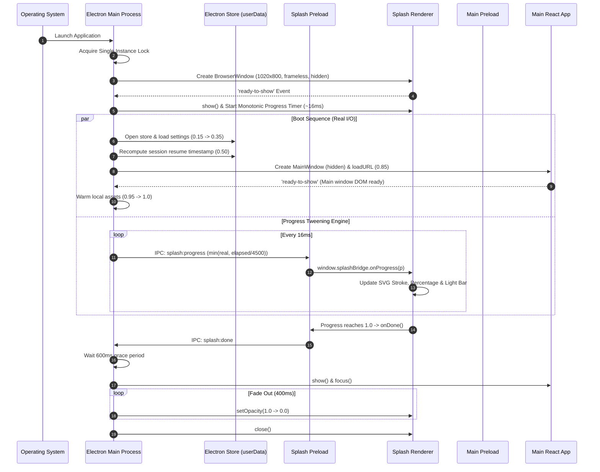

# 01 — Foundation, Splash & Boot Sequence

---

## 1. What We Built

### Like I'm 10
Imagine you have a spaceship. Before you can sit in the pilot chair and fly, the spaceship boots up: the glowing cockpit dashboard lights up first, checks the fuel tanks, warms the engines, and tests the navigation computer. You watch a smooth glowing light bar fill up without any sudden skips or jumps. Once the spaceship is 100% stable and ready, the dashboard smoothly dissolves away and hands you the flight controls.

### CS Student Level
We engineered the core foundation and startup pipeline for **Still**, an offline-first Windows desktop recovery companion. The system utilizes Electron's multi-process architecture with strict process isolation, sandboxing, and Content Security Policy (CSP). On launch, the main process acquires an OS single-instance lock, renders a frameless, hardware-accelerated, multi-corner video splash screen, executes real asynchronous initialization routines (store initialization, library defaults, session resume recomputation, main window DOM readiness, and asset warmup), and drives a continuous 60 FPS (~16ms) monotonic tween so visual feedback never stutters or jumps even when I/O completes rapidly. Upon boot finalization, the splash window fades its window opacity over 400ms and yields focus to the main application shell.

```
+==========================================================================+
|                         OS PROCESS ISOLATION                             |
|                                                                          |
|  +--------------------------------------------------------------------+  |
|  |                 ELECTRON MAIN PROCESS (Node.js)                    |  |
|  |   - Single-Instance Lock                                           |  |
|  |   - Boot Sequence Orchestration (Real I/O Stages)                  |  |
|  |   - 60 FPS Monotonic Progress Interpolation Timer (~16ms)          |  |
|  |   - Persistent Storage (electron-store / OS userData)              |  |
|  +------------------+------------------------------+------------------+  |
|                     |                              |                     |
|           IPC Channel (Progress)         IPC Channel (Done)              |
|                     v                              ^                     |
|  +------------------+---------+     +--------------+------------------+  |
|  |   SPLASH RENDERER WINDOW   |     |    MAIN SHELL RENDERER WINDOW   |  |
|  |   - Frameless (1020x800)   |     |    - Hidden until Boot Finishes |  |
|  |   - Sandboxed / Isolated   |     |    - React 19 + TypeScript      |  |
|  |   - Local JetBrains Mono   |     |    - Tailwind v4 Theme Tokens   |  |
|  |   - Dual Corner Videos     |     |    - "Session setup comes next" |  |
|  +----------------------------+     +---------------------------------+  |
+==========================================================================+
```

---

## 2. Why This Order: What Came First and Why

1. **Scaffold & Configuration First**: Multi-process Electron development requires distinct compilation targets for Node.js (main/preload) and browser environments (renderer). Establishing `electron.vite.config.ts`, `tsconfig.json`, and `@tailwindcss/vite` first guarantees end-to-end type safety and builds before any UI or business logic is implemented.
2. **Shared Types & IPC Protocol Contracts Second**: In multi-process applications, interfaces (`src/shared/types.ts`) define the boundary protocols between processes. Establishing them prevents IPC channel divergence and runtime messaging errors.
3. **Design Tokens & Theme Isolation Third**: Injecting the exact frozen color palette, motion curves, and font stacks into `tokens.css` and clearing default Tailwind colors via `@theme { --color-*: initial; }` prevents unapproved styling from leaking into the UI.
4. **Preload Security Bridges Fourth**: Implementing sandboxed preloads with `contextBridge` ensures the renderer cannot directly touch Node.js or `ipcRenderer`, enforcing strict zero-trust security boundaries.
5. **Splash Window & Frozen Visual Asset Integration Fifth**: Integrating `src/renderer/splash/index.html` with bundled local fonts and local video assets (`assets/corner.mp4`) ensures complete zero-network, offline startup fidelity.
6. **Main Process Boot Orchestration & Interpolation Sixth**: Coordinating the asynchronous store initialization, main window preloading, and 60 FPS progress tweening in `src/main/boot.ts` ties the whole sequence together smoothly.
7. **Main Application Shell Last**: Once the lifecycle, transition, and security gates are verified, the React application shell is mounted cleanly.

---

## 3. Install and Command Log

| Package / Command | What It Is | Why This Over Alternatives | What Breaks Without It |
|---|---|---|---|
| `electron` (`^34.2.0`) | Cross-platform desktop runtime combining Chromium and Node.js | Industry standard for rich native desktop apps with web frontends | App cannot run as a desktop application |
| `electron-vite` (`^3.0.0`) | Build tool integrating Vite specifically for Electron multi-process | Native support for multi-page renderers, HMR, and auto-externalization | Bundler would bundle Node built-ins into browser code or fail on preload builds |
| `@tailwindcss/vite` (`^4.0.9`) & `tailwindcss` (`^4.0.9`) | Next-gen CSS styling engine with CSS-first configuration | Direct `@theme` token mapping in pure CSS without complex JS config files | Styling utilities fail to compile or leak unapproved Tailwind colors |
| `@fontsource/jetbrains-mono` (`^5.1.1`) | Locally bundled JetBrains Mono typeface | Guarantees 100% offline font loading without relying on external CDNs or Google Fonts | App violates strict offline runtime requirements or fails when disconnected |
| `electron-store` (`^8.2.0`) | File-backed JSON key-value store in OS `userData` | Handles cross-platform path resolution, atomic disk writes, and schema migration | App loses user settings, session resume timestamps, and recovery preferences across restarts |
| `react` & `react-dom` (`^19.0.0`) | Component-based UI library for browser DOM rendering | Declarative component hierarchy and state management | Interactive UI shell cannot be rendered |
| `electron-builder` (`^25.1.8`) | Desktop installer and packager for Windows/macOS/Linux | Creates code-signed NSIS Windows executables and portable bundles | Cannot package production `.exe` / installer for end users |
| `npm run dev` | Starts `electron-vite` in development mode with live HMR | Enables instant feedback loop across main, preload, and renderer targets | Manual restarts required after every code change |
| `npm run build` | Runs strict typechecking across targets and produces optimized production bundles | Validates type safety and optimizes bundle size | Runtime type errors or broken asset paths in production |

---

## 4. Files Created or Changed

```
Still/
├── package.json                          # Project manifest, scripts, and locked dependencies
├── electron.vite.config.ts               # Multi-target build config for Main, Preload, and Renderer
├── tsconfig.json                         # Master TypeScript config referencing Node and Web targets
├── tsconfig.node.json                    # TypeScript strict compiler config for Main, Preload & Config
├── tsconfig.web.json                     # TypeScript strict compiler config for React & Renderer
├── src/
│   ├── main/
│   │   ├── index.ts                      # Main process lifecycle, single-instance lock & CSP header enforcement
│   │   ├── boot.ts                       # Asynchronous boot orchestration & 60 FPS progress tween engine
│   │   └── store.ts                      # Persistent storage configuration & schema defaults
│   ├── preload/
│   │   ├── index.ts                      # Main window preload script exposing typed API via contextBridge
│   │   ├── splash.ts                     # Splash window preload exposing only window.splashBridge
│   │   └── index.d.ts                    # TypeScript global declarations for Window interface
│   ├── shared/
│   │   └── types.ts                      # Shared contracts: Settings, Session, Library, IPC Channels
│   └── renderer/
│       ├── index.html                    # Main application HTML entry point with CSP meta tag
│       ├── src/
│       │   ├── App.tsx                   # Centered main window recovery shell component
│       │   ├── main.tsx                  # React 19 bootstrap mount
│       │   └── env.d.ts                  # Vite client ambient typings
│       ├── splash/
│       │   ├── index.html                # Frozen splash page with local JetBrains Mono & video
│       │   └── assets/
│       │       └── corner.mp4            # Local offline corner video loop
│       └── styles/
│           ├── tokens.css                # Frozen color palette, motion curves, and font stacks
│           └── main.css                  # Tailwind v4 @theme token mapping and global resets
└── docs/
    ├── README.md                         # Master documentation index
    ├── GLOSSARY.md                       # Comprehensive system and OS glossary
    ├── LEARNING_RULES.md                 # Standing documentation principles and rules
    └── notes/
        └── 01-foundation-splash-boot.md  # Architectural note for Task 01
```

---

## 5. Concepts Used This Time

### 5.1 Electron Architecture (Main / Renderer / Preload)
- **Like I'm 10**: Think of a restaurant. The **Main Process** is the master chef in the kitchen who has full access to the pantry, stove, and back door. The **Renderer Process** is the customer sitting in the dining room who can only look at the menu. The **Preload Script** is the careful waiter who passes messages back and forth so customers can never run into the kitchen and touch dangerous knives.
- **CS Student Level**: Electron separates concerns into a single privileged Node.js process (**Main**) and one or more isolated Chromium rendering processes (**Renderers**). The main process orchestrates window creation, native operating system hooks, and persistent file I/O. Renderers execute web content inside sandboxed environments. The **Preload script** runs in a privileged context before the DOM loads, selectively exposing safe functions across the boundary using `contextBridge`.
- **Repo Example**:
  - `src/main/index.ts` (Lines 1-48): Lifecycle and window creation.
  - `src/preload/splash.ts` (Lines 1-17): Exposing `splashBridge` to the renderer.

```
+--------------------------------------------------------------------------+
|                            MAIN PROCESS                                  |
|         (Node.js Runtime, File System, OS Window Management)             |
+------------------------------------+-------------------------------------+
                                     |
                          IPC (Inter-Process Comm)
                                     |
+------------------------------------v-------------------------------------+
|                           PRELOAD SCRIPT                                 |
|            (Privileged contextBridge API Translation Gate)               |
+------------------------------------+-------------------------------------+
                                     |
                          Isolated Function Calls
                                     |
+------------------------------------v-------------------------------------+
|                          RENDERER PROCESS                                |
|        (Sandboxed Chromium Window, React 19 DOM, CSS Animations)         |
+--------------------------------------------------------------------------+
```

---

### 5.2 BrowserWindow & Frameless Windows
- **Like I'm 10**: A regular window has a thick frame, a blue title bar, and minimize/maximize/close buttons. A **frameless window** is like a borderless picture frame floating in the air, giving the app a sleek, custom look.
- **CS Student Level**: `BrowserWindow` encapsulates an OS-level native window (e.g. Win32 `HWND` on Windows). Setting `frame: false` strips the default OS non-client window decoration (title bar, standard control buttons, and OS borders), allowing full client-area rendering up to the window boundaries. Setting `show: false` and listening for `'ready-to-show'` prevents visual flicker and blank white flashes during initial rendering.
- **Repo Example**: `src/main/boot.ts` (Lines 13-28):
```typescript
const splashWindow = new BrowserWindow({
  width: 1020,
  height: 800,
  center: true,
  frame: false,
  resizable: false,
  skipTaskbar: true,
  backgroundColor: '#000000',
  show: false,
  webPreferences: {
    preload: join(__dirname, '../preload/splash.js'),
    contextIsolation: true,
    nodeIntegration: false,
    sandbox: true
  }
})
```

---

### 5.3 Security: Context Isolation, Node Integration, Sandbox, CSP & Single-Instance Lock
- **Like I'm 10**: If you invite a guest into your house, you don't give them the master key to every locked room and your safe. You put up strong doors (**sandbox**), keep them in the living room (**context isolation**), forbid dangerous tools (**node integration false**), only serve food from your trusted kitchen (**CSP**), and make sure only one party happens at a time (**single-instance lock**).
- **CS Student Level**:
  - `contextIsolation: true`: Ensures scripts in the preload run in an isolated JavaScript execution context from the web page window object, preventing prototype pollution or privilege escalation.
  - `nodeIntegration: false`: Removes `require()`, `process`, and `Buffer` from the renderer global scope.
  - `sandbox: true`: Leverages Chromium's OS-level sandbox to restrict process system call privileges.
  - `Content-Security-Policy (CSP)`: Enforces `default-src 'self'; connect-src 'none';` to block unauthorized remote scripts, websockets, and remote data exfiltration.
  - `app.requestSingleInstanceLock()`: Uses an OS-level mutex to ensure subsequent launches redirect focus to the primary process rather than spawning duplicate instances.
- **Repo Example**: `src/main/index.ts` (Lines 6-17, 31-41).

| Security Setting | Enabled Value | Risk When Disabled / Misconfigured |
|---|---|---|
| `contextIsolation` | `true` | Malicious renderer scripts can overwrite prototypes and hijack preload functions |
| `nodeIntegration` | `false` | Cross-site scripting (XSS) leads directly to arbitrary remote code execution (RCE) |
| `sandbox` | `true` | Compromised renderer can make direct operating system system calls |
| `Content Security Policy` | Strict (`'self'`, `connect-src 'none'`) | Renderer can load unauthorized remote code or exfiltrate user data |
| `requestSingleInstanceLock` | `true` | Concurrent instances corrupt local database files and fight over user data |

---

### 5.4 Why Timers and Progress Interpolation Live in the Main Process
- **Like I'm 10**: If a runner gets distracted and takes a nap, the stopwatch should keep ticking accurately on the coach's wrist. The coach updates the scoreboard smoothly so the crowd sees steady progress.
- **CS Student Level**: Chromium renderer timers (`setInterval`, `requestAnimationFrame`) are subject to aggressive background throttling, tab sleeping, and garbage collection pauses. Placing the boot progress clock and tween interpolation engine in the Electron Main process ensures a deterministic, hardware-accurate ~16ms tick rate. Furthermore, using `Math.min(realProgress, elapsedMs / 4500)` guarantees that even if asynchronous I/O completes in 100ms, visual progress advances smoothly without jumps.
- **Repo Example**: `src/main/boot.ts` (Lines 40-62):
```typescript
const tweenInterval = setInterval(() => {
  if (splashWindow.isDestroyed()) {
    clearInterval(tweenInterval)
    return
  }
  const elapsedMs = Date.now() - startTime
  const timeProgress = Math.min(1.0, elapsedMs / MIN_BOOT_DURATION_MS)
  const targetProgress = Math.min(realProgress, timeProgress)

  if (targetProgress > displayedProgress) {
    displayedProgress = targetProgress
  }

  splashWindow.webContents.send(IPC_CHANNELS.SPLASH_PROGRESS, displayedProgress)

  if (displayedProgress >= 1.0 && realProgress >= 1.0) {
    clearInterval(tweenInterval)
  }
}, 16)
```

---

### 5.5 Tailwind CSS v4 `@theme` & Token Isolation
- **Like I'm 10**: When coloring a drawing, you lock away the box of 200 rainbow crayons and only keep the 10 special pencils you were given. No one can accidentally use the wrong blue!
- **CS Student Level**: Tailwind CSS v4 replaces JavaScript-based `tailwind.config.js` with direct CSS `@theme` directives. By defining `--color-*: initial;`, all standard Tailwind utility colors (e.g. `bg-blue-500`, `text-red-400`) are unbound and pruned. Only our explicitly registered custom properties (`--color-accent`, `--color-bg-deep`, etc.) compile, enforcing strict design token compliance.
- **Repo Example**: `src/renderer/styles/main.css` (Lines 5-27):
```css
@theme {
  --color-*: initial;
  --color-bg: var(--bg);
  --color-bg-deep: var(--bg-deep);
  --color-accent: var(--accent);
  --color-accent-hi: var(--accent-hi);
  --color-accent-core: var(--accent-core);
  --color-text: var(--text);
  --color-muted: var(--muted);
  --color-faint: var(--faint);
  --color-track: var(--track);
  --color-hair: var(--hair);
  --color-hud-border: var(--hud-border);
}
```

---

### 5.6 Operating System Fundamentals: Process vs Thread, Monotonic vs Wall Clock, Z-Order
- **Process vs Thread**:
  - A **Process** is an independent executing program with its own private virtual memory space, file handles, and security context (e.g. Electron Main vs Renderer).
  - A **Thread** is a lightweight execution stream *inside* a process that shares memory and address space with other threads in the same process.
- **Wall Clock vs Monotonic Clock**:
  - **Wall Clock** (`Date.now()`): Measures human calendar time. It can jump backwards or forwards due to daylight saving adjustments, user edits, or NTP sync.
  - **Monotonic Clock** (`performance.now()`): Measures elapsed hardware time continuously moving forward, making it immune to clock skew and ideal for animations and tweening.
- **Z-Order & Window Layering**:
  - Desktop operating systems manage overlapping windows using a 1D coordinate along the Z-axis perpendicular to the screen. Setting window opacity, focus, and show sequences dictates which window surface is rendered on top.

| OS Concept | Process | Thread |
|---|---|---|
| Memory Space | Private, dedicated virtual address space | Shared with all threads in parent process |
| Crash Impact | Process crash is isolated; does not kill OS | Unhandled thread exception can terminate parent process |
| Communication | IPC (pipes, sockets, shared memory, serialization) | Direct shared memory read/write with mutexes/locks |
| Creation Overhead | Heavy (allocates page tables, descriptors, env) | Light (allocates stack and register state) |

---

## 6. How the Pieces Talk: Main Boot & Lifecycle Sequence



---

## 7. Common Mistakes and How to Debug Them

1. **White Flash on Window Launch**:
   - *Symptom*: When opening a window, a bright white rectangle appears for a fraction of a second before the dark UI renders.
   - *Cause*: Creating the `BrowserWindow` with `show: true` (default) before Chromium finishes parsing and painting the DOM.
   - *Fix*: Pass `show: false` and `backgroundColor: '#000000'` in `BrowserWindow` constructor options, then attach a `ready-to-show` one-time listener: `window.once('ready-to-show', () => window.show())`.

2. **Accidental IPC Leaks via Preload**:
   - *Symptom*: Passing `ipcRenderer` directly to `window.electron = { ipcRenderer }`.
   - *Cause*: Developer convenience exposing full IPC capabilities to the web page.
   - *Fix*: Never expose `ipcRenderer`. Wrap every event in explicit, typed callbacks via `contextBridge.exposeInMainWorld('splashBridge', { onProgress, done })`.

3. **Progress Bar Jumps from 0% to 100% Instantly**:
   - *Symptom*: On fast NVMe SSDs, the splash bar blinks to 100% and immediately disappears.
   - *Cause*: Tying visual progress directly to raw I/O completion without elapsed-time tweening.
   - *Fix*: Calculate `targetProgress = Math.min(realProgress, elapsedMs / 4500)` in the main process timer loop.

4. **Tailwind Color Contamination**:
   - *Symptom*: Developers use `bg-blue-600` or `text-gray-400` which violate the project's strict frozen tokens.
   - *Cause*: Leaving Tailwind's default color palette enabled.
   - *Fix*: Add `--color-*: initial;` inside the `@theme` block in `main.css`.

---

## 8. Interview Questions & Model Answers

### Q1: Why does Electron use a multi-process architecture instead of a single multi-threaded process?
**Answer**: Chromium processes web content in separate renderer processes so that a memory leak, heavy computation, or fatal crash in one tab/window does not terminate the entire application or corrupt the browser kernel. In Electron, this also creates a critical security sandbox: untrusted web code runs without direct operating system or file system privileges, which are isolated inside the Node.js Main process.

### Q2: What is the exact difference between `nodeIntegration: false` and `contextIsolation: true`?
**Answer**: `nodeIntegration: false` removes Node.js global symbols (`require`, `process`, `Buffer`) from the renderer execution context. `contextIsolation: true` goes further by running the preload script in a completely separate JavaScript context from the renderer's DOM window object. Without context isolation, a malicious script in the renderer could modify JavaScript prototypes (e.g. `Array.prototype.push`) to hijack or tamper with preload logic.

### Q3: Why is it critical to enforce a Content Security Policy (CSP) even in an offline desktop application?
**Answer**: Even offline apps can parse untrusted user input, load malicious SVGs, or become vulnerable to Cross-Site Scripting (XSS). A strict CSP (`default-src 'self'; connect-src 'none';`) prevents injected scripts from fetching remote payloads, executing arbitrary `eval()`, or sending sensitive local data to external attacker servers.

### Q4: How does `app.requestSingleInstanceLock()` work at the operating system level?
**Answer**: Electron requests an OS-level synchronization primitive (such as a named mutex on Windows or a domain socket on Unix). If another process already holds the lock, `requestSingleInstanceLock()` returns `false`, signaling the second process to exit immediately while notifying the first process via the `second-instance` event to restore and focus its primary window.

### Q5: Why should progress tweening and animation timers be orchestrated from the Main process rather than the Renderer?
**Answer**: Chromium aggressively throttles renderer timers (`requestAnimationFrame`, `setTimeout`) when a window is occluded, unfocused, or running heavy layout recalculations. The Node.js event loop in the Main process is unthrottled and guarantees a deterministic, uniform ~16ms tick rate regardless of window rendering load.

### Q6: What is the purpose of `@theme { --color-*: initial; }` in Tailwind CSS v4?
**Answer**: In Tailwind CSS v4, `--color-*: initial;` unbinds and clears the entire default color palette (slate, gray, blue, red, etc.). This ensures that only the design tokens explicitly mapped within the `@theme` block exist in the compiled CSS, turning any unapproved utility class (like `bg-blue-500`) into a build-time compiler error.

### Q7: Where does `electron-store` persist data on Windows, and why should apps use `userData` instead of the local executable directory?
**Answer**: On Windows, `electron-store` writes to `%APPDATA%\[AppName]\` (the OS `userData` directory). Modern operating systems enforce User Account Control (UAC) and write-protect `C:\Program Files\`. Storing runtime data in `userData` ensures non-elevated write permissions, multi-user isolation, and persistent settings across app updates.

### Q8: What is the difference between Wall Clock time and Monotonic Clock time in software systems?
**Answer**: Wall clock time (`Date.now()`) represents human calendar time and can jump forward or backward due to daylight saving adjustments, NTP synchronization, or manual clock changes. Monotonic clock time (`performance.now()`) is a hardware-backed timer that moves strictly forward at a uniform rate, making it the only safe clock source for measuring elapsed durations, frame intervals, and animations.

---

## 9. Try It Yourself: 3 Safe Experiments

### Experiment 1: Verify Tailwind Token Isolation
1. Open `src/renderer/src/App.tsx`.
2. Add a temporary element with an unapproved utility class: `<div className="bg-blue-500 text-red-500">Test</div>`.
3. Observe that Tailwind v4 does not output any background or text color styles for these classes because `--color-*: initial;` stripped them.
4. Replace it with `<div className="bg-accent text-bg">Test</div>` and observe the exact frozen `#AFDDFF` accent applied.

### Experiment 2: Inspect Single-Instance Prevention
1. Run the app with `npm run dev`.
2. In a second terminal window, run `npm run dev` again.
3. Notice that the second instance immediately terminates, while the existing window is focused on screen.

### Experiment 3: Inspect IPC Security Isolation
1. Open DevTools in the main window (`Ctrl+Shift+I`).
2. Type `window.ipcRenderer` or `require('electron')` in the Console.
3. Observe that both return `undefined` or throw a reference error, proving that `contextIsolation: true` and `nodeIntegration: false` are active.

---

## 10. Recap in 5 Bullets

- **Multi-Process Architecture**: Electron isolates Node.js system capabilities (Main) from browser DOM rendering (Splash and Main renderers) via sandboxed preload bridges.
- **Frozen Visual Splash**: The splash screen runs locally with zero remote network calls, using locally bundled JetBrains Mono and offline corner videos.
- **Hardware-Smooth Boot Tween**: Main process timer advances progress using `min(realProgress, elapsedMs / 4500)` every ~16ms, ensuring smooth 60 FPS animation without jumps.
- **Zero-Trust Security**: `contextIsolation`, `sandbox`, `single-instance lock`, and strict CSP headers (`connect-src 'none'`) protect the application against XSS and duplicate instances.
- **Design Token Purity**: Tailwind v4 `@theme` resets all default utility colors to `initial`, enforcing strict compliance with the frozen `#000000` / `#AFDDFF` palette.
