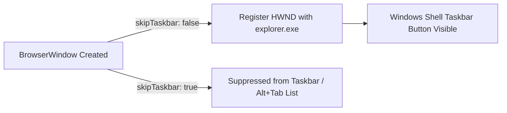
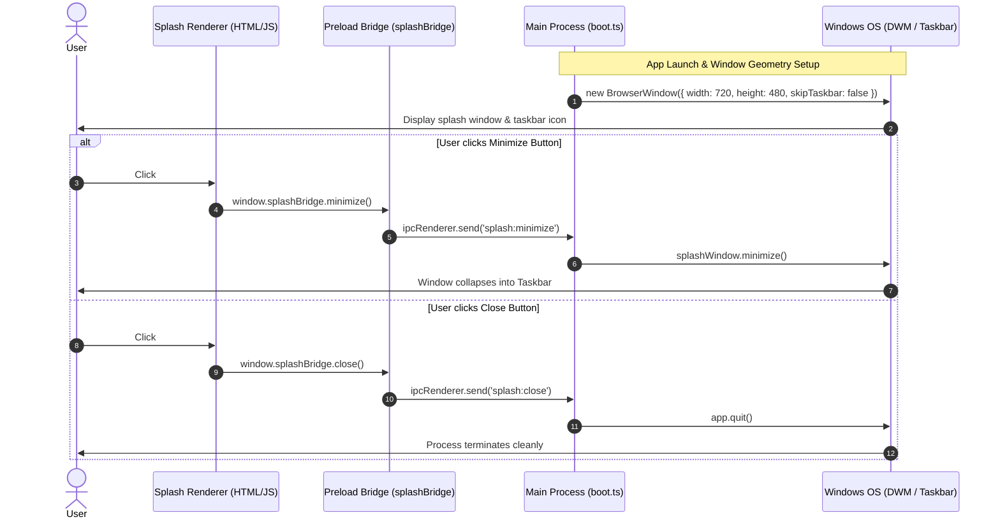

# 02 — Window Geometry, Taskbar Visibility & Native Window Controls

---

## 1. What We Built

### Like I'm 10
Imagine you have a cool secret diary with glowing neon lights on the front cover. At first, the diary was as huge as a giant poster board, and when you put it on your school desk, nobody could even see the tab sticking out of your backpack. Also, you could only shut it completely, but you couldn't tuck it away under your desk when you wanted to take a quick break.

We gave your diary the perfect compact size so it fits neatly on your desk. We made the glowing cursive handwritten name "Still" on the cover smaller, sharper, and more delicate. We made sure its icon pops right up on your computer's taskbar tray the moment you open it so you never lose it, and we added a "hide" (minimize `─`) button right next to the "close" (`✕`) button so you can tuck it away whenever you want!

### CS Student Level
We refined the desktop application's window geometry, operating system shell integration, and client-side window control routing across Electron's multi-process architecture. Specifically:
1. **Unified Custom Window Geometry**: Configured both the splash window and the main application shell to identical **`900x720`** viewport dimensions (`minWidth: 600, minHeight: 600`), ensuring a seamless transition during boot finalization with zero window resizing jump or layout shift.
2. **SVG Vector Scaled Typography**: Balanced the organic multi-layer neon cursive wordmark in `refer/splash.html` (`#mark { width: min(65vw, 470px); }`) with hardware subpixel `shape-rendering="geometricPrecision"` and proportional jellyfish element dimensions.
3. **OS Shell Taskbar Presence**: Removed the `skipTaskbar: true` constraint (`skipTaskbar: false`), enabling Windows Shell (`explorer.exe`) Taskbar thumbnail grouping and window switcher (`Alt+Tab`) enumeration directly upon process startup.
4. **Frameless IPC Window Control Pipeline**: Integrated a custom titlebar control group with native IPC channels (`splash:minimize` and `splash:close`) bridged through a sandboxed context-isolated preload script to allow users to minimize or terminate the frameless window without native OS non-client chrome.

```
+========================================================================================+
|                              WINDOWS OS DESKTOP SHELL                                  |
|                                                                                        |
|  +-----------------------------------+        +-------------------------------------+  |
|  |       TASKBAR (explorer.exe)      |        |     FRAMENESS WINDOW (720x480)      |  |
|  |  +-----------------------------+  |        |  +-------------------------------+  |  |
|  |  | [S] Still  (skipTaskbar=0)  |  | <----> |  | Still — Core system  [─] [✕]   |  |  |
|  |  +-----------------------------+  |        |  |                               |  |  |
|  +-----------------------------------+        |  |        (Still Cursive SVG)    |  |  |
|                                               |  |       [=== Loading 45% ===]   |  |  |
|                                               |  +-------------------------------+  |  |
|                                               +-------------------+-----------------+  |
+===================================================================|====================+
                                                                    |
                                                   IPC (splash:minimize / splash:close)
                                                                    v
                                               +--------------------+-----------------+
                                               |    MAIN PROCESS (Electron / Node)    |
                                               |   - splashWindow.minimize()          |
                                               |   - app.quit()                       |
                                               +--------------------------------------+
```

---

## 2. Why This Order: What Came First and Why

1. **Shared Contract Types First (`src/shared/types.ts`)**: We defined the protocol channel constants (`SPLASH_MINIMIZE`, `SPLASH_CLOSE`) and the typed interface methods on `SplashBridge` first to ensure compile-time type safety across both process boundaries.
2. **Preload Security Bridge Second (`src/preload/splash.ts`)**: We exposed safe, parameterless `minimize()` and `close()` functions to `window.splashBridge` within the isolated context, strictly preventing the web page from accessing `ipcRenderer` directly.
3. **Main Process OS Handlers Third (`src/main/boot.ts`)**: We updated `BrowserWindow` constructor geometry (`900x720`), toggled `skipTaskbar: false`, and registered `ipcMain.on` listeners to execute native OS window actions (`minimize()`, `app.quit()`).
4. **Renderer UI & Styles Fourth (`refer/splash.html` & `prepare-splash.cjs`)**: We updated the DOM markup to include the `-webkit-app-region: no-drag` minimize and close buttons, adjusted vector SVG scaling tokens, and compiled the assets into `src/renderer/splash/`.
5. **Verification & Typechecking Last**: Executed full TypeScript compilation (`npm run typecheck`) and bundler build (`npm run build`) to ensure zero regressions.

---

## 3. Install and Command Log

| Package / Command | What It Is | Why This Over Alternatives | What Breaks Without It |
|---|---|---|---|
| `npm run typecheck` | Runs `tsc --noEmit` across `tsconfig.node.json` and `tsconfig.web.json` | Validates end-to-end type safety between shared IPC definitions, preload, and main process | Type mismatches or broken IPC signatures slip into runtime silently |
| `node scripts/prepare-splash.cjs` | Asset preparation script | Injects local bundled fonts and prepares standalone splash HTML from reference design | Splash requires external internet font CDNs or diverges from reference templates |
| `npm run build` | Multi-target Vite bundler for Electron | Bundles Main, Preload, and Renderer code into `out/` with tree shaking | Application cannot be packaged into a standalone desktop executable |

---

## 4. Files Created or Changed

| File Path | Purpose | Architectural Location |
|---|---|---|
| [src/shared/types.ts](file:///c:/Users/JAYA%20GANGWANI/OneDrive/Desktop/Still/src/shared/types.ts#L38-L54) | Extended `SplashBridge` interface and added `SPLASH_MINIMIZE` / `SPLASH_CLOSE` channel constants | IPC Boundary Protocol |
| [src/preload/splash.ts](file:///c:/Users/JAYA%20GANGWANI/OneDrive/Desktop/Still/src/preload/splash.ts#L11-L16) | Implemented and exposed `minimize()` and `close()` via `contextBridge` | Security Sandbox Preload |
| [src/main/boot.ts](file:///c:/Users/JAYA%20GANGWANI/OneDrive/Desktop/Still/src/main/boot.ts#L14-L44) | Unified splash & main window to 900x720, set `skipTaskbar: false`, wired IPC listeners | OS Window Lifecycle (Main) |
| [refer/splash.html](file:///c:/Users/JAYA%20GANGWANI/OneDrive/Desktop/Still/refer/splash.html#L28-L75) | Scaled down SVG wordmark, added minimize (`─`) & close (`✕`) buttons with event bindings | Splash UI Template |
| [scripts/prepare-splash.cjs](file:///c:/Users/JAYA%20GANGWANI/OneDrive/Desktop/Still/scripts/prepare-splash.cjs#L1-L25) | Synchronized local font replacement and compiled splash output | Build & Asset Pipeline |
| [docs/notes/02-window-geometry-taskbar-controls.md](file:///c:/Users/JAYA%20GANGWANI/OneDrive/Desktop/Still/docs/notes/02-window-geometry-taskbar-controls.md) | Architectural documentation and OS concepts learning record | Documentation |
| [docs/README.md](file:///c:/Users/JAYA%20GANGWANI/OneDrive/Desktop/Still/docs/README.md) | Index catalog of all architectural learning modules | Documentation |
| [docs/GLOSSARY.md](file:///c:/Users/JAYA%20GANGWANI/OneDrive/Desktop/Still/docs/GLOSSARY.md) | Updated system and OS engineering terminology index | Documentation |

---

## 5. Concepts Used This Time

### 1. `skipTaskbar` and OS Taskbar Grouping

#### Kid Explanation
When you launch a video game on your computer, a little button for that game appears at the very bottom of your monitor on the taskbar. If a programmer tells the computer "skip taskbar", the window appears on screen like a ghost without any icon on the bottom bar, making it hard to find if you click away!

#### CS Student Level
In the Win32 subsystem, a top-level `HWND` with the `WS_VISIBLE` style automatically registers an `ITaskbarList` entry with the Windows Explorer shell (`Shell_TrayWnd`), unless created with the `WS_EX_TOOLWINDOW` extended window style or explicitly suppressed via Electron's `skipTaskbar: true`. Setting `skipTaskbar: false` ensures the window registers an `AppUserModelID` button in the Windows Taskbar, enabling task switching (`Alt+Tab`), hover thumbnails, and window state management.



### 2. Client-Area Window Controls in Frameless Windows

#### Kid Explanation
Normal windows have a blue or grey top bar with an "X" and a minus sign provided by Windows. When we turn that off to make our app look sleek and seamless, we have to draw our own little buttons and tell the computer: "When the user clicks my minus sign, hide the window!"

#### CS Student Level
When `frame: false` is configured on a `BrowserWindow`, the operating system omits the non-client area (titlebar, system menu, minimize/maximize/close buttons, and standard window borders). The application must render its own client-area controls and route interactions across the IPC security boundary via `ipcRenderer.send()` -> `ipcMain.on()` -> `BrowserWindow.minimize()` / `app.quit()`. Interactive elements must also declare `-webkit-app-region: no-drag` so mouse clicks are not intercepted as window drag events.

| Property / Strategy | Native Window Chrome (`frame: true`) | Custom Client-Area Chrome (`frame: false`) |
|---|---|---|
| **Rendered By** | Operating System (DWM / Win32 non-client) | Chromium DOM / HTML / CSS |
| **Styling Flexibility** | Rigid OS styling / standard titlebar | 100% custom colors, fonts, hover animations |
| **Min / Close Handling** | Handled automatically by OS kernel messages (`WM_CLOSE`, `WM_SYSCOMMAND`) | Routed manually via IPC to Electron Main process |
| **Drag Area** | Handled natively by OS titlebar | Configured via CSS `-webkit-app-region: drag` |

### 3. SVG Vector Subpixel Precision & Proportional Scaling

#### Kid Explanation
If you draw a cursive word on a rubber balloon and stretch it, you want the curves to stay smooth and clean without looking jagged or pixelated.

#### CS Student Level
Scalable Vector Graphics (SVG) define shapes using mathematical Bézier curves (`C x1 y1, x2 y2, x y`). When rendering complex multi-stroke layered strokes (e.g., `#wall`, `#interior`, `#light`, `#core`) at smaller container sizes, setting `shape-rendering="geometricPrecision"` instructs the 2D graphics engine (Blink/Skia) to prioritize subpixel curve anti-aliasing over rendering speed, avoiding aliasing artifacts on high-DPI displays.

```typescript
// Code snippet from refer/splash.html (Lines 39 & 70)
// Scaled responsive wordmark with geometric precision
// #mark { width: min(44vw, 380px); shape-rendering: geometricPrecision; }
```

---

## 6. How the Pieces Talk



---

## 7. Common Mistakes and How to Debug Them

1. **Window controls unclickable in frameless window**:
   - *Symptom*: Clicking the minimize or close button does nothing; instead, dragging the button moves the whole window.
   - *Cause*: The parent header has `-webkit-app-region: drag`, which captures all mouse events.
   - *Fix*: Explicitly add `-webkit-app-region: no-drag` to the button elements and interactive controls.
2. **Missing taskbar icon despite `skipTaskbar: false`**:
   - *Symptom*: Window appears on screen but does not register in the Windows taskbar.
   - *Cause*: Window was created with `type: 'toolbar'` or child window parenting (`parent: otherWindow`), which implicitly suppresses taskbar entries on Windows.
   - *Fix*: Ensure top-level windows do not inherit parent window handles if independent taskbar presence is desired.
3. **Ghost processes when closing frameless splash**:
   - *Symptom*: Closing the splash window hides the window but leaves the Electron Node.js process running in Task Manager.
   - *Cause*: Calling `window.close()` only closes the renderer web page without notifying the main process to invoke `app.quit()`.
   - *Fix*: Forward the close request through IPC channel `SPLASH_CLOSE` so `ipcMain` can trigger `app.quit()`.

---

## 8. Interview Questions

1. **Q: What is the difference between `skipTaskbar: true` and `skipTaskbar: false` in Electron?**
   *A:* `skipTaskbar: true` applies the `WS_EX_TOOLWINDOW` extended style on Windows (or equivalent on other platforms) to prevent the window from creating an entry in the OS Taskbar or `Alt+Tab` switcher. Setting it to `false` creates a standard top-level application window with full taskbar representation and thumbnails.
2. **Q: How does `-webkit-app-region: drag` interact with DOM click events?**
   *A:* In Chromium-based desktop runtimes, elements marked as `drag` redirect native pointer events directly to OS window movement routines (`WM_NCLBUTTONDOWN`). Children that require click interactivity must explicitly override this using `-webkit-app-region: no-drag`.
3. **Q: Why should frameless window close buttons invoke `app.quit()` rather than simply closing the DOM window?**
   *A:* If background tasks, timers, or uncollected resources exist in the main process, closing the window object without terminating the application lifecycle leaves orphan Node.js worker threads active in memory.
4. **Q: What are the trade-offs of using `shape-rendering: geometricPrecision` on SVG elements?**
   *A:* `geometricPrecision` forces the 2D rendering pipeline to perform subpixel curve antialiasing calculation on vector primitives, producing smoother curves at the cost of slightly higher CPU/GPU rasterization overhead compared to `optimizeSpeed`.
5. **Q: Why are IPC channels defined as frozen objects (`as const`) in TypeScript?**
   *A:* Declaring channel dictionaries with `as const` creates immutable literal types for channel strings, allowing TypeScript to catch typos at compile time across main, preload, and renderer layers.
6. **Q: What happens if a BrowserWindow's `minWidth` is greater than its initialized `width`?**
   *A:* Electron clamps the initialized dimensions to the specified minimum constraints, causing the OS to force the window to expand to `minWidth` immediately on creation.
7. **Q: How do you prevent multiple IPC listeners from accumulating when reloading renderer windows during HMR?**
   *A:* Use `ipcMain.once()` for one-time events, or clean up existing listeners with `ipcMain.removeHandler()` / `ipcMain.removeAllListeners()` before rebinding.
8. **Q: What is the role of `autoHideMenuBar: true` on Windows?**
   *A:* It hides the traditional Win32 menu bar (File, Edit, View) from the top of the window while allowing users to access it by pressing the `Alt` key, maintaining a clean modern aesthetic without breaking accessibility.

---

## 9. Try It Yourself

1. **Taskbar Toggle Experiment**:
   - Change `skipTaskbar: false` to `skipTaskbar: true` in `src/main/boot.ts` and restart the app.
   - *Expected Result*: The splash screen appears on your screen, but no icon or preview appears in the Windows Taskbar at the bottom of the screen.
2. **Window Control Interactivity Experiment**:
   - Temporarily remove `-webkit-app-region: no-drag` from `.win-btn` in `refer/splash.html`.
   - *Expected Result*: Clicking on the minimize or close buttons will drag the entire window instead of triggering the click event.
3. **Responsive Wordmark Resize**:
   - Modify `#mark` width from `min(44vw, 380px)` to `min(25vw, 200px)` in `refer/splash.html` and run `node scripts/prepare-splash.cjs`.
   - *Expected Result*: The glowing cursive handwriting signature renders in a super-compact, ultra-delicate miniature format while maintaining full neon glow fidelity.

---

## 10. Recap in 5 Bullets

- **Unified Custom Geometry**: Configured both the splash window and main application shell to matching **`900x720`** dimensions (`minWidth: 600, minHeight: 600`).
- **Proportional Cursive Wordmark**: Scaled the SVG mark to **`min(65vw, 470px)`** with `shape-rendering="geometricPrecision"` for razor-sharp subpixel rendering.
- **Taskbar Visibility**: Configured `skipTaskbar: false` so the application immediately populates the Windows Taskbar upon launch.
- **Client-Area Window Controls**: Added dedicated Minimize (`─`) and Close (`✕`) buttons with `-webkit-app-region: no-drag` in the splash top bar.
- **Secure IPC Routing**: Routed window management actions through typed `splashBridge` methods and `IPC_CHANNELS` to native main process APIs (`minimize()` and `app.quit()`).
