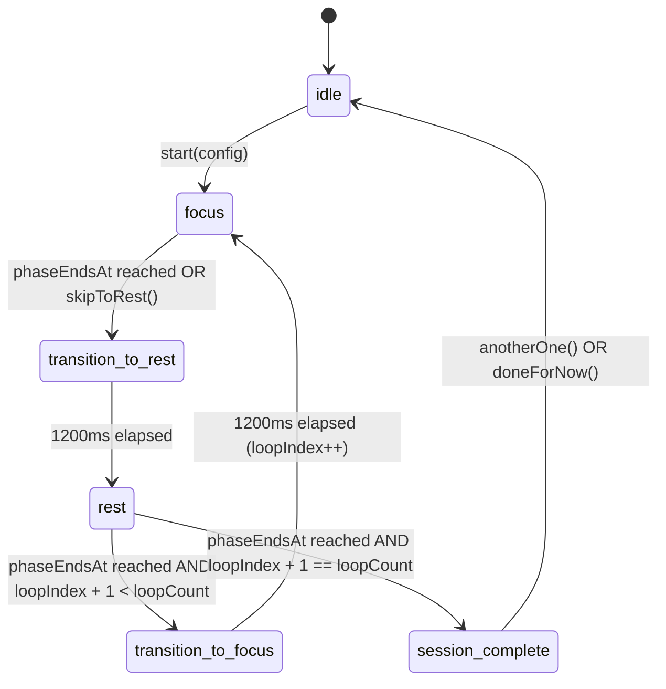
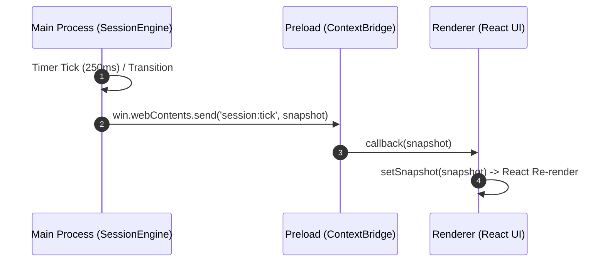
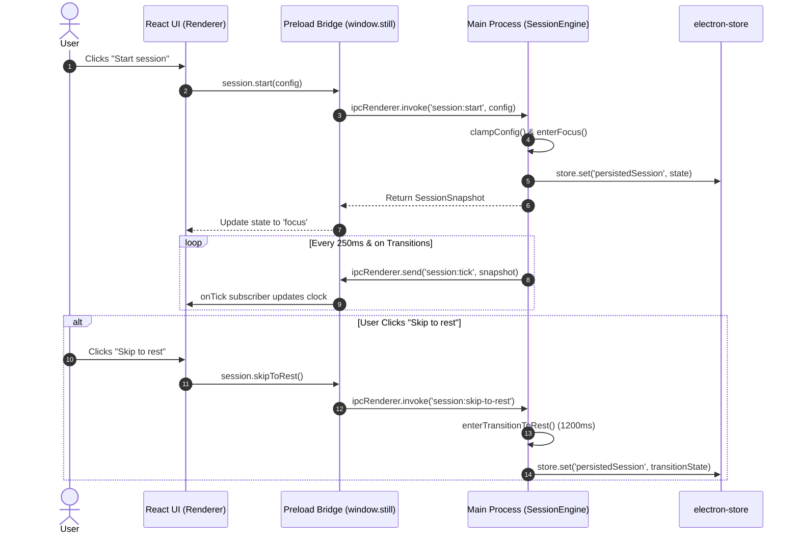

# 03 — Focus Screen & Authoritative Session Engine

---

## 1. What We Built

### Like I'm 10
Imagine a smart kitchen oven with a digital chef inside. When you want to bake cookies, you don't just guess the time by counting in your head while playing video games. Instead, the smart oven looks at the real kitchen clock on the wall. Even if you turn off the kitchen lights, go to sleep, or close the kitchen door for an hour, when you walk back in, the smart oven checks the wall clock and knows *exactly* how much baking time is left or if your cookies are done and ready to eat!

We built the **Focus Screen** and its **Session Engine**. It has a sleek dashboard where you pick how many minutes you want to focus, how many minutes you want to rest, and how many rounds to do. When you press "Start session", the brain of the app (the main process) takes full control of the clock. It counts down smoothly, guides you from focus into rest, remembers your choices even if you restart your computer, and lets you pick special breathing exercises for each rest round.

### CS Student Level
We engineered an authoritative, state-machine-driven session lifecycle engine in Electron's Main Process coupled with a responsive, token-constrained React UI rendered with Tailwind CSS v4 in the Renderer Process.
1. **Deterministic State Machine (`src/main/sessionEngine.ts`)**: Built a formal finite state machine (`idle` → `focus` → `transition-to-rest` → `rest` → `transition-to-focus` → `session-complete`) utilizing wall-clock `Date.now()` delta calculations instead of fragile browser `setInterval` tick accumulators.
2. **Context-Isolated Preload Bridge (`src/preload/index.ts`)**: Exposed a strictly typed `window.still` API across the sandbox boundary using `contextBridge`, providing IPC endpoints for snapshot querying, transitions (`start`, `skipToRest`, `anotherOne`, `doneForNow`), slot activity assignment, and reactive snapshot event subscriptions (`session:tick`).
3. **Power Event & Relaunch Hydration**: Persisted active session metadata (`config`, `loopIndex`, `phase`, `phaseEndsAt`) to `electron-store`. On application boot or OS ACPI sleep/wake events (`powerMonitor.on('resume')`), the engine calculates elapsed time against `Date.now()` and advances to the correct state without replaying stale intervals.
4. **Pixel-Accurate Token UI**: Faithfully ported `refer/session-setup.html` into React, enforcing uppercase typography, `@fontsource/jetbrains-mono`, zero default Tailwind color palettes, glowing tabular counters, collapsible sidebar navigation (216px/64px with `1.1s cubic-bezier(0.16, 1, 0.3, 1)` easing), and debounced preferences persistence.
5. **Headless Injectable Test Suite (`src/main/__tests__/sessionEngine.test.ts`)**: Verified state transitions, skip guards, activity fallback cascades, and timestamp expiration handling using Vitest and a deterministic simulated clock.

```
+===================================================================================================+
|                                    RENDERER PROCESS (React + Tailwind v4)                        |
|                                                                                                   |
|   +-------------------+  +--------------------------------------------------------------------+   |
|   | SIDEBAR (64/216px)|  | FOCUS SCREEN SETUP & RUNNING VIEWS                                  |   |
|   | [Focus] (active)  |  |  [Get ready to focus]              [Rest activities]                |   |
|   | [Activities]      |  |  Focus: [ 30 ] mins (+/-)          Slot 1: Box breathing (4-4-4-4) |   |
|   | [Settings]        |  |  Rest:  [  5 ] mins (+/-)          Slot 2: 4-7-8 breathing        |   |
|   |                   |  |  Rounds:[  2 ] today(+/-)          [Start session]                  |   |
|   +-------------------+  +--------------------------------------------------------------------+   |
+===================================================|===============================================+
                                                    | window.still.session / window.still.prefs
                                                    | (contextBridge / IPC Channels)
                                                    v
+===================================================================================================+
|                                      MAIN PROCESS (Authoritative)                                 |
|                                                                                                   |
|   +-------------------------+     +-------------------------------+     +---------------------+   |
|   |      SessionEngine      | <-> |  electron-store (Persistence) | <-> | powerMonitor (OS)   |   |
|   |  - State Machine        |     |  - prefs.json                 |     |  - 'resume' event   |   |
|   |  - Date.now() Diffing   |     |  - persistedSession.json      |     +---------------------+   |
|   |  - 250ms IPC Broadcast |     +-------------------------------+                               |
|   +-------------------------+                                                                     |
+===================================================================================================+
```

---

## 2. Why This Order: What Came First and Why

1. **Shared Contract Types First (`src/shared/types.ts`)**: Defined `SessionPhase`, `SessionConfig`, `SessionSnapshot`, `UserPrefs`, and IPC channel constants first. This prevents interface discrepancies between the Main process state engine and the Renderer UI.
2. **Authoritative Engine & Unit Tests Second (`src/main/sessionEngine.ts` & `src/main/__tests__/sessionEngine.test.ts`)**: Built the core logic with dependency-injectable clock interfaces and verified all 7 critical edge cases (multi-loop progressions, skip guards, invalid config clamping, resume past deadline) in headless isolation with Vitest before attaching UI.
3. **Store & Seed Data Third (`src/main/store.ts`)**: Initialized default user preferences and seeded the Library with the three specified breathing activities (Box 4-4-4-4, 4-7-8, Coherence 5.5-5.5).
4. **Main Process IPC & OS Power Hooks Fourth (`src/main/index.ts` & `src/main/boot.ts`)**: Connected the `SessionEngine` to `ipcMain`, `electron-store`, `powerMonitor`, and set `BrowserWindow` minimum constraints to `860x640`.
5. **Preload Security Gate Fifth (`src/preload/index.ts`)**: Implemented the `window.still` API surface using `contextBridge`, guaranteeing zero leak of raw `ipcRenderer`.
6. **Design System & Tailwind Tokens Sixth (`src/renderer/styles/tokens.css` & `main.css`)**: Reset default Tailwind v4 colors with `--color-*: initial;`, configured JetBrains Mono, card edge gradients, and glow text-shadows.
7. **React Views & App Orchestration Seventh (`src/renderer/src/App.tsx` & components)**: Ported the sidebar, setup cards, running circular clocks, activity picker wiring, and debounced store persistence.

---

## 3. Install and Command Log

| Package / Command | What It Is | Why This Over Alternatives | What Breaks Without It |
|---|---|---|---|
| `npm install -D vitest` | Fast native ESM unit testing framework | Tight Vite integration, fast startup, built-in TypeScript support without heavy Babel transforms | Cannot execute fast, isolated unit tests for the main-process state machine |
| `npm test` | Executes `vitest run` across test suites | Validates core state transitions and clock math in CI/local runs | Undetected race conditions, timing flaws, or invalid resume states slip into production |
| `npm run typecheck` | Compiles `tsc --noEmit` across node & web targets | Enforces strict type contracts between shared types, preload, and React | Type mismatches or undefined IPC arguments cause runtime crashes |

---

## 4. Files Created or Changed

| File Path | One-Line Purpose | Architecture Position |
|---|---|---|
| `src/shared/types.ts` | Shared domain interfaces (`SessionSnapshot`, `UserPrefs`, `Activity`, IPC channels) | Shared Type Layer |
| `src/main/sessionEngine.ts` | Authoritative session state machine with wall-clock diffing & resume logic | Main Process Core Logic |
| `src/main/__tests__/sessionEngine.test.ts` | Vitest unit test suite covering full session flows and edge cases | Main Process Test Layer |
| `src/main/store.ts` | Store schema, default preferences, and built-in activity seeding | Main Process Persistence |
| `src/main/index.ts` | IPC handlers, powerMonitor hooks, and broadcast dispatch | Main Process Entry Point |
| `src/main/boot.ts` | Window geometry constraints (`900x720`, min `860x640`) and boot stages | Main Process Lifecycle |
| `src/preload/index.ts` | Sandboxed `window.still` contextBridge bridge API | IPC Boundary Gatekeeper |
| `src/preload/index.d.ts` | TypeScript declarations for global `window.still` | Renderer Type Layer |
| `src/renderer/styles/tokens.css` | Raw design token custom properties and easing definitions | Renderer Styling System |
| `src/renderer/styles/main.css` | Tailwind v4 `@theme` mappings, resets, animations, and typography | Renderer Styling System |
| `src/renderer/src/components/Stars.tsx` | Ambient background particle field with 40 faint twinkling stars | Renderer Visual Layer |
| `src/renderer/src/components/Sidebar.tsx` | Collapsible navigation sidebar (216px / 64px) with easing transitions | Renderer Navigation Component |
| `src/renderer/src/components/FocusScreen.tsx` | Focus setup cards, live countdown rings, rest views, and completion modal | Renderer Primary View |
| `src/renderer/src/components/ActivitiesScreen.tsx` | Temporary activity slot assignment view for Rest slots | Renderer Auxiliary View |
| `src/renderer/src/components/SettingsScreen.tsx` | Minimal settings placeholder screen | Renderer Auxiliary View |
| `src/renderer/src/App.tsx` | Root component managing routing, IPC event subscriptions, and debounced store sync | Renderer Root Controller |

---

## 5. Concepts Used This Time

### 1. State Machines

#### Like I'm 10
Think of a traffic light. It can be Green, Yellow, or Red. It can never be Green and Red at the exact same time, and it can only go from Green to Yellow, then Yellow to Red. A state machine is a strict set of rules that prevents the traffic light from going crazy or jumping directly from Red to Yellow without warning.

#### CS Student Level
A Finite State Machine (FSM) is a mathematical model of computation consisting of a finite set of states, inputs, and transition functions mapping `(State, Event) -> (NextState, SideEffect)`. In Still, the session state machine guarantees determinism: the application can only exist in exactly one of six distinct phases (`idle`, `focus`, `transition-to-rest`, `rest`, `transition-to-focus`, `session-complete`), prohibiting invalid states (e.g. attempting to skip to rest while already resting).



```typescript
// From src/main/sessionEngine.ts (lines 135-144)
public skipToRest(): SessionSnapshot {
  if (this.phase !== 'focus') {
    // Guard: skipping is strictly illegal outside the focus phase
    return this.getSnapshot()
  }
  this.clearTimers()
  this.enterTransitionToRest()
  return this.getSnapshot()
}
```

---

### 2. `Date.now()` Diffing vs `setInterval`

#### Like I'm 10
If you try to count 60 seconds by saying "1 Mississippi, 2 Mississippi", you might get distracted or speak too slowly, and your count will be wrong. But if you look at a real digital clock and subtract when you started from what time it is now, you will never lose a single second.

#### CS Student Level
In JavaScript runtimes, `setInterval(fn, 1000)` does not guarantee precise 1000ms invocation intervals due to event-loop lag, microtask queues, and thread scheduling jitter. If an accumulator increments `secondsElapsed++` on each tick, drift compounds rapidly. Furthermore, if the thread sleeps, ticks are lost entirely. By storing absolute target timestamps (`phaseEndsAt = Date.now() + durationMs`), the remaining duration is dynamically evaluated via `remainingMs = Math.max(0, phaseEndsAt - Date.now())`, achieving zero-drift accuracy.

| Approach | Timing Mechanism | Drift Under Load | Behavior on Sleep / Background |
|---|---|---|---|
| **`setInterval` Counter** | Increments `count += 1` every tick | High cumulative drift | Pauses; upon resume, time is permanently lost |
| **`Date.now()` Diffing (Still)** | Evaluates `phaseEndsAt - Date.now()` | Zero cumulative drift | Instantly detects actual elapsed real-world time |

```typescript
// From src/main/sessionEngine.ts (lines 110-120)
public getSnapshot(): SessionSnapshot {
  const now = this.clock.now()
  const totalMs = this.phase === 'idle' || this.phase === 'session-complete'
    ? 0
    : Math.max(0, this.phaseEndsAt - this.phaseStartedAt)

  const remainingMs = this.phase === 'idle' || this.phase === 'session-complete'
    ? 0
    : Math.max(0, this.phaseEndsAt - now)
  // ...
}
```

---

### 3. Timer Throttling

#### Like I'm 10
When your computer's screen dims or you minimize a game, the computer slows down its internal timer to save battery, like taking a slow, lazy breath. If a timer runs inside that minimized window, it gets slowed down and falls behind.

#### CS Student Level
Chromium aggressively clamps and throttles background timer execution (down to 1 execution per second or even 1 per minute on hidden `BrowserWindow` tabs) to conserve CPU cycles and battery life. Because the Renderer process is subject to Chromium frame and background throttling policies, hosting the session clock in the Renderer produces severe UI stalls. Placing the authoritative timer in Node.js (Main process) and using `Date.now()` delta calculation completely bypasses Chromium timer throttling.

---

### 4. Sleep and Wake

#### Like I'm 10
When your laptop lid closes, your computer goes into a deep sleep and stops thinking. When you open the lid, it wakes up. If 30 minutes passed while it was asleep, Still looks at the clock, realizes the time is up, and smoothly moves to the next step.

#### CS Student Level
During OS sleep states (ACPI S3/S4), the CPU halts instruction execution and monotonic timers stop incrementing. Electron provides the `powerMonitor` module, which listens to native operating system power management notifications (`resume`, `suspend`). Still registers a `powerMonitor.on('resume')` listener that triggers `sessionEngine.handleSystemResume()`, evaluating the elapsed real-world duration against `phaseEndsAt` and immediately transitioning to the appropriate phase.

```typescript
// From src/main/index.ts (lines 40-42)
powerMonitor.on('resume', () => {
  sessionEngine.handleSystemResume()
})
```

---

### 5. IPC Broadcast

#### Like I'm 10
Imagine a school principal speaking through the intercom speakers into every classroom at once. The teacher and students don't need to keep asking "What time is it?"; the principal automatically announces the time every few seconds.

#### CS Student Level
Inter-Process Communication (IPC) in Electron allows data exchange across isolated process spaces. While request-response IPC (`ipcRenderer.invoke` -> `ipcMain.handle`) operates point-to-point, reactive updates benefit from unidirectional broadcast. The main process emits `session:tick` across all active `BrowserWindow.webContents` instances every 250ms and synchronously on phase transitions. The renderer subscribes via a memory-safe listener returning an unsubscribe teardown function.



---

### 6. Resume After Relaunch

#### Like I'm 10
If you are reading a book and have to run to dinner, you put a bookmark on the exact page. When you open the book later, you pick up right where you left off. If it's already bedtime, you skip right to brushing your teeth!

#### CS Student Level
On every state transition, the engine serializes `{ config, loopIndex, phase, phaseEndsAt }` into persistent storage (`electron-store`). If the application crashes or terminates, the subsequent boot sequence inspects the persisted state. If `Date.now() < phaseEndsAt`, it re-hydrates the remaining duration; if `Date.now() >= phaseEndsAt`, it cleanly advances to the successor phase without replaying stale elapsed intervals.

```typescript
// From src/main/sessionEngine.ts (lines 173-207)
public resumeFromPersisted(persisted: PersistedSessionState | null): boolean {
  if (!persisted || persisted.phase === 'idle' || persisted.phase === 'session-complete') {
    this.phase = 'idle'
    return false
  }
  // ...
  const now = this.clock.now()
  if (now < persisted.phaseEndsAt) {
    this.phase = persisted.phase
    this.phaseEndsAt = persisted.phaseEndsAt
    this.scheduleTimers()
    return true
  } else {
    // Phase has passed: advance directly to next phase starting now
    this.advanceFromExpiredPhase(persisted.phase)
    return true
  }
}
```

---

## 6. How the Pieces Talk: Main Flow Sequence Diagram



---

## 7. Common Mistakes and How to Debug Them

1. **Running Timers in the Renderer**:
   - *Mistake*: Setting up `setInterval` in React `useEffect` to decrement remaining seconds.
   - *Consequence*: When the user minimizes or tabs away, Chromium throttles the interval, causing the session to lag or freeze.
   - *Fix*: Keep all timer math in the Main process using `Date.now()` diffing and only broadcast snapshots to the renderer.
2. **Exposing `ipcRenderer` Directly**:
   - *Mistake*: Writing `contextBridge.exposeInMainWorld('electron', { ipcRenderer })`.
   - *Consequence*: Eliminates the security sandbox; any malicious renderer script can invoke arbitrary Node.js APIs.
   - *Fix*: Expose granular, parameter-validated methods on `window.still`.
3. **Replaying Stale Phases on Resume**:
   - *Mistake*: Trying to loop through all intermediate phases that elapsed while the app was closed.
   - *Consequence*: Causes rapid UI flashing and cascade transitions upon relaunch.
   - *Fix*: Advance strictly to the next logical phase starting *now*.
4. **Mutating Configuration Arrays Directly**:
   - *Mistake*: Writing `config.restActivityIds[i] = id` directly in React state.
   - *Consequence*: React misses state changes due to shallow reference equality.
   - *Fix*: Create new array copies (`[...config.restActivityIds]`) and update through debounced persistence helpers.

---

## 8. Interview Questions & Model Answers

### Q1: Why must the session timer live in Electron's Main process rather than the Renderer?
**Answer**: Chromium enforces aggressive timer throttling policies on background or unfocused browser windows, clamping `setInterval` and `requestAnimationFrame` rates to conserve battery. Running the authoritative state machine in Node.js (Main process) ensures timing fidelity regardless of window visibility, minimizing, or DOM lifecycle events.

### Q2: How does `Date.now()` diffing eliminate timing drift?
**Answer**: `setInterval` is vulnerable to event-loop delays and thread latency, causing cumulative drift over long durations. `Date.now()` diffing calculates remaining time by subtracting the current wall-clock timestamp from a target timestamp (`phaseEndsAt - Date.now()`). This makes timing completely stateless and resilient to momentary thread stalls.

### Q3: How should an application handle timer expiration when the operating system wakes from sleep?
**Answer**:Monotonic timers halt while the OS is suspended. By listening to Electron's `powerMonitor.on('resume')`, the application triggers a state reconciliation that compares `Date.now()` against `phaseEndsAt`. If the deadline has elapsed, the engine advances directly to the next phase starting at the wake timestamp.

### Q4: Why is debouncing necessary when persisting UI counter values to `electron-store`?
**Answer**: `electron-store` synchronously serializes and writes JSON to disk. If counter chevron clicks triggered immediate file writes on every increment, rapid user clicking would trigger excessive blocking disk I/O. Debouncing by ~300ms coalesces rapid changes into a single atomic write once the user stops interacting.

### Q5: What security risks are avoided by wrapping IPC in `contextBridge`?
**Answer**: Without `contextBridge`, web pages could directly access `ipcRenderer.send()` and exploit arbitrary IPC channels. Context isolation ensures that the renderer receives only safe, strongly-typed JS closures that sanitize and validate input before crossing into the privileged Main process.

### Q6: What is the purpose of the 1200ms transition phases (`transition-to-rest` and `transition-to-focus`)?
**Answer**: Transition phases act as fixed architectural buffers in the state machine. They provide dedicated windows for UI entrance/exit animations and upcoming full-screen recovery overlays without deducting time from the user's configured focus or rest intervals.

### Q7: Why should design token resets like `--color-*: initial;` be used in Tailwind CSS v4?
**Answer**: By default, Tailwind v4 provides a broad utility palette of generic colors and box shadows. Overriding default tokens with `--color-*: initial;` inside `@theme` restricts the utility engine to project-specific tokens, guaranteeing visual consistency and preventing accidental style divergence.

### Q8: How does an injectable clock simplify unit testing asynchronous state machines?
**Answer**: Testing real 30-minute focus sessions with standard `setTimeout` is impractical in test suites. Injecting a `MockClock` interface that allows manual time advancement (`clock.advanceTime(ms)`) enables testing multi-hour complex session progressions synchronously in milliseconds.

---

## 9. Try It Yourself: 3 Safe Experiments

### Experiment 1: Dev Speed Multiplier
1. Set the environment variable in your terminal: `STILL_DEV_SPEED=60`
2. Launch the app (`npm run dev`).
3. Set Focus to 5 minutes and Rest to 1 minute, then click "Start session".
4. **Expected Result**: 5 minutes of focus will count down in exactly 5 seconds, followed by a 1.2s transition and a 1-second rest phase.

### Experiment 2: Relaunch Hydration Test
1. Start a 30-minute focus session in normal dev mode.
2. Observe the timer counting down (e.g. at 29:50).
3. Close the application completely.
4. Wait 10 seconds and relaunch the application.
5. **Expected Result**: The application boots and immediately resumes the focus phase at approximately 29:40 without losing state.

### Experiment 3: Activity Slot Customization
1. On the Focus setup screen, increase Rounds to 3.
2. Click "Choose activity" on Rest 1 and select "Box breathing (4-4-4-4)".
3. Notice the slot border turns into a luminous accent line with a glowing dot.
4. Reduce Rounds to 1, then increase it back to 3.
5. **Expected Result**: The configured "Box breathing" assignment for Rest 1 is preserved and reappears.

---

## 10. Recap in 5 Bullets

- **Authoritative Main Process Engine**: All timing and state transitions are computed in the Node.js Main process using wall-clock `Date.now()` deltas.
- **Strict Deterministic FSM**: Enforces valid state transitions (`idle` → `focus` → `transition-to-rest` → `rest` → `transition-to-focus` → `session-complete`) and prevents illegal actions like mid-focus terminations.
- **Resilient Persistence & Resume**: Stores session snapshots and preferences to `electron-store`, recovering correctly across app crashes, relaunches, and OS sleep/wake cycles.
- **Pixel-Accurate Token UI**: Matches `refer/session-setup.html` in React + Tailwind v4 with JetBrains Mono, glowing tabular counters, and collapsible sidebar animations.
- **Comprehensive Unit Testing**: Fully tested using Vitest and an injectable clock, covering multi-loop sessions, skip actions, and fallback resolution.
