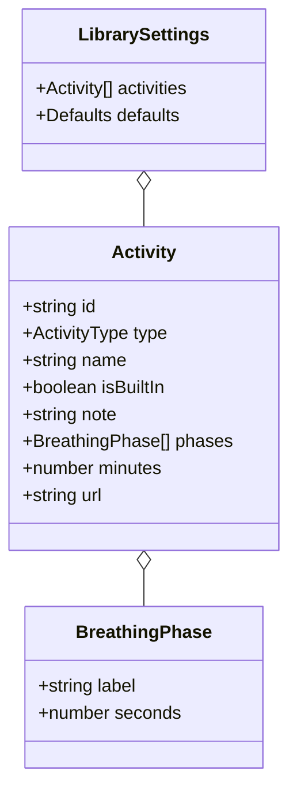
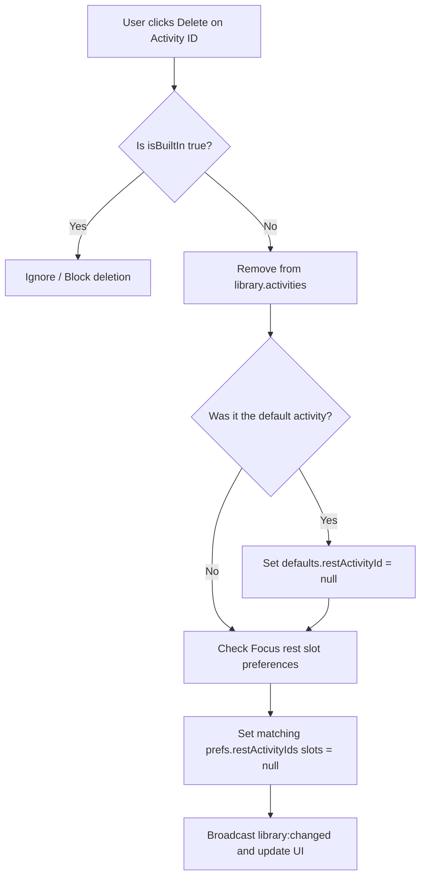
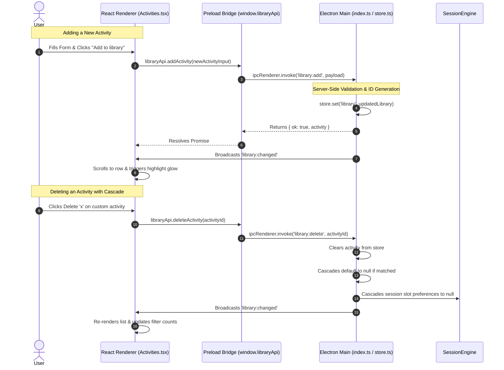

# 04 — Activities Screen, Library Data Modeling, CRUD & Validation

In this milestone, we built the **Activities screen**: the library where users browse, add, delete, filter, and assign recovery activities (Breathing exercises, Custom timed tasks, YouTube videos, and Spotify audio). We engineered authoritative data modeling and persistence in the Electron Main process with JSON-schema backing, context-isolated IPC channels, rich dynamic React forms with zero layout-shift validation, and cascade deletion integrity across Focus session slots.

---

## 1. What We Built

### Like I'm 10 (Analogy: The Activity Box & Lego Instructions)
Imagine you have a big toy box where you keep recipe cards for fun breaks—like blowing bubbles, listening to a favorite song tape, or taking a 10-minute walk outside. Some recipe cards came with the box when you bought it from the store (we call those "built-ins"), so nobody is allowed to tear them up or throw them in the trash. But you can write your own recipe cards with colorful markers, pick one as your "favorite" card of the day, or pick a card to put into your homework schedule for your afternoon recess. Whenever you write a new card, a teacher double-checks that you wrote your name and real instructions before sliding it into the box.

### CS Student Level
We engineered an offline-first **CRUD (Create, Read, Update, Delete)** domain model for recovery activities in a multi-process Electron architecture:
- **Authoritative Main Process Store**: Managed via `electron-store` schema migrations with strict seed data generation (3 immutable built-in breathing techniques and 1 deletable custom activity).
- **Relational Integrity & Cascading Deletions**: When an activity is removed, foreign key references (`defaults.restActivityId` in the library and `prefs.restActivityIds` across Focus round slots) cascade to `null` to avoid dangling identifiers.
- **Bi-directional IPC & Context Isolation**: Preload-exposed `window.libraryApi` implementing query methods (`getLibrary`), command mutations (`addActivity`, `deleteActivity`, `setDefault`), and reactive broadcasts (`onLibraryChanged`).
- **Dynamic Reactive Forms & Proportional Cycle Visualizer**: Controlled React multi-phase builder with live flex-basis calculations, regex-based URL validation for media platforms, and error handling without layout shift.
- **Session Slot Pick Navigation**: Modal navigation routing from Focus rest round slots (`{ mode: 'pick', slotIndex }`), rendering contextual indicator banners and action pills to assign rest activities into live session state.

---

## 2. Why This Order: What Came First and Why

```
┌──────────────────────────────────────────────────────────┐
│ Step 1: Shared Domain Types (shared/types.ts)            │
│ Define Activity, LibrarySettings, IPC Channels & API     │
└────────────────────────────┬─────────────────────────────┘
                             │
┌────────────────────────────▼─────────────────────────────┐
│ Step 2: Main Process Persistence & IPC Handlers          │
│ Seed electron-store, write validation & cascade deletes  │
└────────────────────────────┬─────────────────────────────┘
                             │
┌────────────────────────────▼─────────────────────────────┐
│ Step 3: Preload Security Bridge (preload/index.ts)       │
│ Expose window.libraryApi with secure IPC isolation       │
└────────────────────────────┬─────────────────────────────┘
                             │
┌────────────────────────────▼─────────────────────────────┐
│ Step 4: UI Components & Dynamic Form Builder             │
│ FilterTiles, CycleBar, ActivityRow, AddActivityForm      │
└────────────────────────────┬─────────────────────────────┘
                             │
┌────────────────────────────▼─────────────────────────────┐
│ Step 5: Screen Orchestration & Session Pick Integration  │
│ ActivitiesScreen, routing, banner pick mode & tests      │
└──────────────────────────────────────────────────────────┘
```

1. **Shared Types First**: Establishing TypeScript interfaces and IPC channel string constants ensures the Main and Renderer processes compile against the exact same contract without type drift.
2. **Main Store & Validation Second**: The persistence and mutation logic was implemented and unit-tested before writing UI to ensure data integrity cannot be bypassed by client-side bugs.
3. **Preload Layer Third**: Exposing `window.libraryApi` via `contextBridge` allowed the React frontend to cleanly call typed methods without touching raw `ipcRenderer`.
4. **UI Components Fourth**: Atomic components (`CycleBar`, `FilterTiles`, `ActivityRow`, `AddActivityForm`) were built and styled against design tokens.
5. **App Wiring & Route Coordination Fifth**: Integrating the pick mode banner, Focus screen slot navigation, and cascade deletions into the unified desktop workflow.

---

## 3. Install and Command Log

All tooling utilizes the existing repository dependencies (`electron-vite`, `react`, `typescript`, `@fontsource/jetbrains-mono`, `electron-store`, `vitest`).

| Command | Purpose | Why This Choice / Tool | What Breaks Without It |
|---|---|---|---|
| `npm run typecheck` | Runs `tsc --noEmit` across all process workspaces. | Validates type safety across `main`, `preload`, `renderer`, and `shared`. | IPC payloads or component props could have undetected type mismatches at runtime. |
| `npm test` | Runs the Vitest test runner for Main & Store logic. | Executes automated unit tests for validation rules, seed logic, and cascade deletes. | Regressions in store migrations or deletion cascades go unnoticed. |
| `npm run dev` | Launches the Electron Vite dual-process development server with HMR. | Fast local development with hot reload for React Renderer and watch for Main. | Manual recompilation and window restarting would be required on every code change. |

---

## 4. Files Created or Changed

| File Path | Purpose | Architectural Layer |
|---|---|---|
| [`src/shared/types.ts`](file:///c:/Users/JAYA%20GANGWANI/OneDrive/Desktop/Still/src/shared/types.ts) | Domain interfaces (`Activity`, `LibrarySettings`, `BreathingPhase`) and IPC channel definitions. | Shared Protocol Contract |
| [`src/main/store.ts`](file:///c:/Users/JAYA%20GANGWANI/OneDrive/Desktop/Still/src/main/store.ts) | Electron-store configuration, initial seed data generation, and collapsed sidebar state. | Main / Persistence |
| [`src/main/index.ts`](file:///c:/Users/JAYA%20GANGWANI/OneDrive/Desktop/Still/src/main/index.ts) | IPC handlers for `library:get`, `library:add`, `library:delete`, `library:set-default`, and broadcast dispatch. | Main / Process Orchestration |
| [`src/main/__tests__/library.test.ts`](file:///c:/Users/JAYA%20GANGWANI/OneDrive/Desktop/Still/src/main/__tests__/library.test.ts) | Unit tests verifying input validation, URL regex parsing, seed rules, and cascade deletions. | Main / Test Suite |
| [`src/preload/index.ts`](file:///c:/Users/JAYA%20GANGWANI/OneDrive/Desktop/Still/src/preload/index.ts) | Context-bridge exposure of `window.libraryApi` with IPC isolation. | Preload / Security Boundary |
| [`src/preload/index.d.ts`](file:///c:/Users/JAYA%20GANGWANI/OneDrive/Desktop/Still/src/preload/index.d.ts) | Global TypeScript definitions for `window.libraryApi`. | Renderer / Type Declarations |
| [`src/renderer/src/components/Icon.tsx`](file:///c:/Users/JAYA%20GANGWANI/OneDrive/Desktop/Still/src/renderer/src/components/Icon.tsx) | SVG icons (`all`, `breathing`, `custom`, `youtube`, `spotify`, `x`, `toggle`, `focus`, `activities`, `settings`). | Renderer / Atom Component |
| [`src/renderer/src/components/FilterTiles.tsx`](file:///c:/Users/JAYA%20GANGWANI/OneDrive/Desktop/Still/src/renderer/src/components/FilterTiles.tsx) | 5 top filter tiles displaying live activity counts with accent glow and toggle selection. | Renderer / Molecule Component |
| [`src/renderer/src/components/CycleBar.tsx`](file:///c:/Users/JAYA%20GANGWANI/OneDrive/Desktop/Still/src/renderer/src/components/CycleBar.tsx) | Visual proportional bar for breathing phases using flex segment widths and total cycle calculation. | Renderer / Molecule Component |
| [`src/renderer/src/components/ActivityRow.tsx`](file:///c:/Users/JAYA%20GANGWANI/OneDrive/Desktop/Still/src/renderer/src/components/ActivityRow.tsx) | Activity item row with metadata line, quote notes, default toggle, delete button, and pick mode Use button. | Renderer / Molecule Component |
| [`src/renderer/src/components/AddActivityForm.tsx`](file:///c:/Users/JAYA%20GANGWANI/OneDrive/Desktop/Still/src/renderer/src/components/AddActivityForm.tsx) | Dynamic 4-type creation form with phase builder, URL validation, and zero-shift error line. | Renderer / Organism Component |
| [`src/renderer/src/screens/Activities.tsx`](file:///c:/Users/JAYA%20GANGWANI/OneDrive/Desktop/Still/src/renderer/src/screens/Activities.tsx) | Main Activities screen composing filter tiles, library list, pick banner, and addition forms. | Renderer / Page Screen |
| [`src/renderer/src/App.tsx`](file:///c:/Users/JAYA%20GANGWANI/OneDrive/Desktop/Still/src/renderer/src/App.tsx) | Root application router coordinating sidebar, Focus, Activities, and slot pick navigation. | Renderer / App Root |
| [`src/renderer/styles/main.css`](file:///c:/Users/JAYA%20GANGWANI/OneDrive/Desktop/Still/src/renderer/styles/main.css) | Tailored CSS styling matching the approved design specifications and tokens. | Renderer / Style System |

---

## 5. Concepts Used This Time

### A. Data Modeling & Discriminated Unions

#### Like I'm 10
Think of a lunch menu where you can choose a Drink, a Sandwich, or a Soup. Every order has your Name on it, but a Soup card asks for "Cup or Bowl?", while a Drink card asks for "With ice or no ice?". In computer code, we give every item a special `type` tag so the computer knows which extra questions to ask.

#### CS Student Level
Data modeling in TypeScript leverages **Tagged (Discriminated) Unions** and structured schemas to enforce type safety at compile time and validate payloads at runtime. An `Activity` shares common fields (`id`, `name`, `isBuiltIn`, `note`) while supporting subtype-specific properties (`phases` for breathing, `minutes` for custom, `url` for media streaming).



```typescript
// src/shared/types.ts (lines 14-25)
export type ActivityType = 'breathing' | 'custom' | 'youtube' | 'spotify'

export interface BreathingPhase {
  label: string
  seconds: number
}

export interface Activity {
  id: string
  type: ActivityType
  name: string
  isBuiltIn: boolean
  note?: string
  phases?: BreathingPhase[]
  minutes?: number
  url?: string
}
```

---

### B. CRUD (Create, Read, Update, Delete) & Authoritative Store

#### Like I'm 10
CRUD is just four basic rules for your sticker album:
1. **Create**: Glue a new sticker in.
2. **Read**: Look at all the stickers on your pages.
3. **Update**: Put a gold star on your favorite sticker.
4. **Delete**: Peel a sticker off and throw it in the trash (unless it was printed onto the page by the book maker!).

#### CS Student Level
CRUD operations represent the four fundamental persistent data manipulation primitives. In our desktop app, the Electron Main process acts as the single source of truth (`store.ts` wrapped over `electron-store`), ensuring atomic JSON disk writes and serializing state transitions.

| Operation | Method / Channel | Description | Cascade / Invariant Guard |
|---|---|---|---|
| **Create** | `library:add` | Generates random UUID (`act_${Date.now()}_...`), validates fields in Main, prepends or appends to store. | Rejects invalid URLs, empty names, or out-of-range timers. |
| **Read** | `library:get` | Retrieves the full `LibrarySettings` snapshot from disk storage. | Hydrates seed activities if initial store is empty. |
| **Update** | `library:set-default` | Sets or toggles `defaults.restActivityId` to an activity ID or `null`. | Resets active default if matching ID is re-clicked. |
| **Delete** | `library:delete` | Removes an activity by ID from `library.activities`. | **Immutable Guard**: Blocks deletion of `isBuiltIn: true`. **Cascades**: Clears default and references in session slots. |

---

### C. Validation & Foreign Key Cascade Integrity

#### Like I'm 10
Imagine you have a weekly chore chart on your fridge with magnets for "Walk the Dog". If you give your dog away to grandma, you can't leave "Walk the Dog" magnets on your Tuesday chore chart! You have to wipe those spots clean so nobody gets confused. Also, if someone tries to write a chore called "fly to Mars in 2 seconds", you tell them "Nope, that's not a real chore!"

#### CS Student Level
Validation ensures data correctness before persisting mutations. Cascading deletion is a database integrity rule: when a parent record is destroyed, any referencing foreign keys in child relations must either be deleted or set to `null` to prevent **dangling pointers**.



```typescript
// src/main/index.ts (Deletion cascade implementation)
ipcMain.handle(IPC_CHANNELS.LIBRARY_DELETE, (_event, id: string) => {
  const library = store.get('library', defaultLibrary) as LibrarySettings
  const target = library.activities.find((a) => a.id === id)
  if (!target || target.isBuiltIn) return

  // 1. Remove from activity array
  const updatedActivities = library.activities.filter((a) => a.id !== id)
  const updatedDefaults = { ...library.defaults }

  // 2. Cascade: clear default reference
  if (updatedDefaults.restActivityId === id) {
    updatedDefaults.restActivityId = undefined
  }
  store.set('library', { activities: updatedActivities, defaults: updatedDefaults })

  // 3. Cascade: clear Focus rest slots referencing this activity
  const prefs = store.get('prefs', defaultPrefs) as any
  if (Array.isArray(prefs.restActivityIds)) {
    const updatedSlotIds = prefs.restActivityIds.map((slotId: string | null) =>
      slotId === id ? null : slotId
    )
    store.set('prefs', { ...prefs, restActivityIds: updatedSlotIds })
  }
  sessionEngine.handleActivityDeleted(id)

  // 4. Broadcast changes
  broadcastLibrary()
})
```

---

### D. Controlled React Forms & Non-Disruptive Live Feedback

#### Like I'm 10
When you type in a search box, the screen shouldn't lose your blinking cursor or jump around when you type a letter. The cycle bar updates smoothly beneath your fingers just like a speedometer needle moving as you pedal your bicycle.

#### CS Student Level
In React, **Controlled Components** bind input values directly to state (`value={state}` and `onChange={e => setState(...)}`). By structuring the `AddActivityForm` with modular state and calculating derived visual values (such as `CycleBar` segment flex proportions and total seconds) on every render, the UI responds instantaneously without remounting DOM elements or stealing caret focus.

```
Cycle Bar Flex Calculation:
Phase 1: Inhale 4s  ─► flex: 4  (4 / 10 = 40% width, opacity: 0.85)
Phase 2: Exhale 6s  ─► flex: 6  (6 / 10 = 60% width, opacity: 0.30)
```

---

## 6. How the Pieces Talk: Main Sequence Flow



### ASCII Architecture Diagram

```
+========================================================================+
|                        ELECTRON MAIN PROCESS                           |
|  +------------------------+        +--------------------------------+  |
|  |     electron-store     | <----> |        IPC Main Handlers       |  |
|  | (library, prefs, seed) |        | (library:add, delete, cascade) |  |
|  +------------------------+        +--------------------------------+  |
+===================================|====================================+
                                    | (IPC Invoke / Broadcast)
+===================================v====================================+
|                           PRELOAD BRIDGE                               |
|        contextBridge.exposeInMainWorld('libraryApi', { ... })          |
+===================================|====================================+
                                    | (Window Method Calls)
+===================================v====================================+
|                       REACT RENDERER PROCESS                           |
|  +------------------------------------------------------------------+  |
|  | FilterTiles: Live counts (All, Breathing, Custom, YouTube, Sp.)  |  |
|  | Your Activities: Default-first sorting, Delete, Pick Mode Banner |  |
|  | AddActivityForm: Dynamic Type Picker, CycleBar, Validation Line  |  |
|  +------------------------------------------------------------------+  |
+========================================================================+
```

---

## 7. Common Mistakes and How to Debug Them

| Mistake | Root Cause | How We Prevented / Solved It |
|---|---|---|
| **Caret Focus Lost in Breathing Form** | Generating new keys or re-mounting the input array on every state change. | Kept stable phase indexing and controlled inputs without recreating parent container wrappers. |
| **Dangling Session Slot References** | Deleting an activity that was selected for a Focus rest round left a ghost ID in session storage. | Implemented foreign key cascade in `src/main/index.ts` to reset matching slots in `prefs.restActivityIds` to `null`. |
| **Client-Only Validation Bypass** | Only checking URL syntax in the React frontend allowed invalid data via IPC manipulation. | Mirrored strict URL regex parsing (`youtube.com`, `youtu.be`, `open.spotify.com`) in both the renderer and the Main process handler. |
| **Layout Shift on Form Error** | Conditionally rendering the error text `<div>` only when an error occurs causes surrounding form controls to jump. | Reserved a minimum height (`min-h-[14px]` / `.err`) so the error message renders into existing layout space without layout shifts. |
| **Accidental Mutation of Built-ins** | Allowing the delete action to execute against seeded default activities. | Enforced an immutable check `if (target.isBuiltIn) return;` at both the UI layer (no delete button) and the Main store handler. |

---

## 8. Interview Questions & Answers

### 1. What is the difference between client-side and server-side validation in Electron?
**Answer**: Client-side validation in the Renderer provides instant UI feedback to the user before submitting an action. However, because the Renderer process is an untrusted web environment that can be inspected or manipulated via DevTools, the Electron Main process must always perform authoritative server-side validation before writing data to disk storage.

### 2. How do you implement a cascading delete in an embedded document store like `electron-store`?
**Answer**: Because embedded JSON document stores lack native relational foreign key constraints, cascading deletions must be handled manually in the mutation handler. When a parent entity (e.g., an `Activity`) is deleted, the handler traverses referencing stores (e.g., `library.defaults.restActivityId` and `prefs.restActivityIds`) and sets any matching IDs to `null` before committing to disk.

### 3. What is a Discriminated Union in TypeScript and why is it useful for domain modeling?
**Answer**: A Discriminated Union is a TypeScript pattern where multiple object types share a common literal property (a "discriminant" such as `type: 'breathing' | 'custom' | 'youtube' | 'spotify'`). When branching with conditional statements or `switch` blocks on the discriminant, TypeScript automatically narrows the type to expose only the relevant subtype properties (e.g., `phases` for breathing, `url` for media).

### 4. Why should you avoid storing API keys or performing raw IPC calls directly inside UI components?
**Answer**: Direct access to Node.js APIs or raw `ipcRenderer` in UI components breaks Electron's security model (Context Isolation and Sandboxing) and creates tight coupling between the view layer and the IPC protocol. Exposing a strongly-typed bridge API (`window.libraryApi`) through the preload script encapsulates IPC channels and isolates privileges.

### 5. How does the pick-mode navigation flow coordinate between the Focus screen and the Activities screen?
**Answer**: When a user clicks "Choose activity" on a Focus rest slot, the app updates its navigation state to `{ screen: 'activities', mode: 'pick', slotIndex }`. The Activities screen renders a contextual banner and "Use" action pills. Clicking "Use" invokes the session engine to assign that activity ID to the selected slot and navigates back to the Focus screen.

### 6. What causes input elements to lose focus during live state updates, and how do you resolve it?
**Answer**: If a component creates sub-components inline inside the render function or changes the `key` prop of an element during state updates, React treats the element as entirely new and unmounts the old DOM node, causing loss of focus and caret position. This is resolved by keeping stable component declarations and using array indexes or fixed identifiers for keys.

### 7. How do you calculate flexbox proportions dynamically for visual indicators like the `CycleBar`?
**Answer**: In CSS Flexbox, setting `flexGrow: phase.seconds` or `flex: ${phase.seconds}` on child elements causes the browser engine to divide available horizontal space proportionally based on the ratio of each phase's duration relative to the total sum of all phase durations.

### 8. Why do we broadcast state changes from the Main process instead of only updating local React state?
**Answer**: In a multi-window or multi-screen desktop application, multiple windows or decoupled screens may depend on the same shared store. Broadcasting `library:changed` from the Main process after every successful mutation guarantees that all active windows and components synchronize with the single source of truth without optimistic state drift.

---

## 9. Try It Yourself: 3 Safe Experiments

### Experiment 1: Test Immutable Built-in Protection
1. Open DevTools in the running app (`Ctrl + Shift + I` or inspect element).
2. Execute the following IPC command in the console:
   ```javascript
   window.libraryApi.deleteActivity('box-breathing')
   ```
3. **Expected Result**: The built-in activity is not deleted, the file on disk remains unchanged, and the UI continues to display all 3 built-in exercises.

### Experiment 2: Observe Live Proportional Cycle Bar Rendering
1. Navigate to the **Activities** screen and ensure the **Breathing** type is selected in the "Add activity" card.
2. In the phase builder, change the "Inhale" seconds from `4` to `20` and the "Exhale" seconds to `5`.
3. **Expected Result**: The first segment of the `CycleBar` immediately expands to consume 80% of the bar's width, the second segment shrinks to 20%, and the cycle summary text updates to `Cycle: 25s · repeats until rest ends` with zero typing lag.

### Experiment 3: Verify Foreign Key Cascade Deletion
1. In the Focus screen, click "Choose activity" on Round 1 Rest and select a custom activity (e.g., "Walk outside").
2. Verify that Round 1 now displays "Walk outside".
3. Navigate to **Activities**, click the delete `x` button on "Walk outside", and navigate back to **Focus**.
4. **Expected Result**: Round 1 automatically resets its rest assignment to empty ("No activity") because the deletion cascaded across the preferences store.

---

## 10. Recap in 5 Bullets

- **Authoritative Library Store**: Seeded with 3 immutable built-in breathing techniques and 1 starter custom activity, backed by `electron-store`.
- **Dynamic 4-Type Creator**: Supports Breathing (1–8 phases with live `CycleBar` proportions), Custom (1–60 min), YouTube, and Spotify formats.
- **Strict Two-Tier Validation**: Client and server-side validation against regex rules, string lengths, and numeric bounds with zero-shift error lines.
- **Relational Cascade Deletion**: Deleting an activity safely clears active default designations and Focus session slot assignments.
- **Seamless Pick Mode**: Focus round slots link directly to the library to choose, swap, or clear rest activities with instant feedback.
