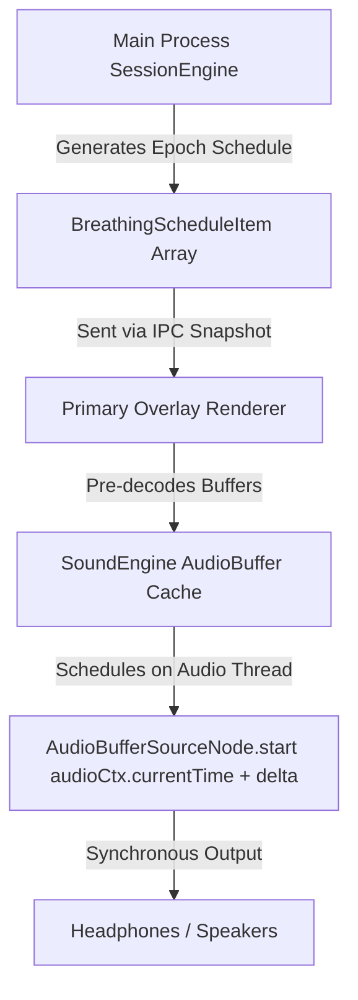
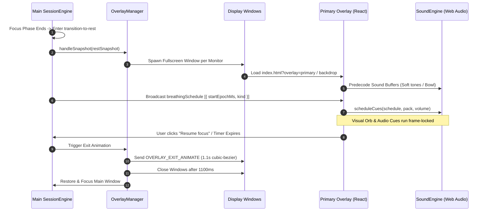

# 05 — Recovery Overlay, Activity Players & Synchronized Audio

---

## 1. What We Built

### Kid Explanation
Imagine you are playing a game on your computer, and when it is time to take a break, your room's main TV and extra screens turn into a calm night sky with gentle twinkling stars. On your main screen, a soft glowing orb breathes in and out with you, counting the seconds and making relaxing sounds like a gentle chime or a singing bowl. On your extra monitors, there are no distracting buttons—just peaceful stars. When the break is over, the night sky smoothly slides away, and you go back to your work feeling refreshed!

### CS Student Explanation
We engineered a multi-display recovery takeover system using Electron's `screen.getAllDisplays()` API. When the authoritative `SessionEngine` enters a rest phase, `OverlayManager` instantiates frameless, always-on-top `BrowserWindow` instances across all active physical monitors (`setAlwaysOnTop(true, 'screen-saver')`). The primary monitor hosts an interactive renderer with specialized activity players (`BreathingPlayer`, `VideoPlayer`, `SpotifyPlayer`, `CustomPlayer`, `MovementPlayer`), while secondary monitors render non-interactive starfield backdrops. For breathing exercises, the main process generates a deterministic epoch schedule (`BreathingScheduleItem[]`), which the renderer's `SoundEngine` schedules against `AudioContext.currentTime` with pre-decoded procedural audio buffers, eliminating JavaScript timer drift.

---

## 2. Why This Order: What Came First and Why
1. **Shared Types & Data Contracts (`src/shared/types.ts`)**: Defined `PhaseKind` (`'in' | 'hold' | 'out'`), `SoundPack`, `BreathingScheduleItem`, and `OverlayAPI` before touching business logic.
2. **Store Migration & Seed Update (`src/main/store.ts`)**: Upgraded stored breathing activities to include phase kinds and seeded default sound packs ("Soft tones", "Singing bowl").
3. **Authoritative Clock & Schedule Generation (`src/main/sessionEngine.ts`)**: Implemented single-clock breathing schedule generation, snooze limits (1 per cycle), and "Resume focus" early exit.
4. **Multi-Display Window Orchestration (`src/main/overlayManager.ts`)**: Created the multi-window manager to spawn and coordinate fullscreen windows across monitors.
5. **Preload Sandboxing (`src/preload/index.ts`)**: Safely exposed overlay IPC methods via `contextBridge`.
6. **Web Audio Synthesis & Audio Engine (`src/renderer/src/audio/SoundEngine.ts`)**: Built procedural audio synthesis and frame-accurate cue scheduling.
7. **Activity Player Components (`src/renderer/src/components/`)**: Built `SharedShell`, `BreathingPlayer`, `VideoPlayer`, `SpotifyPlayer`, `CustomPlayer`, `MovementPlayer`, and `ActivityPicker`.
8. **Root Overlay Router (`src/renderer/src/screens/OverlayScreen.tsx`)**: Wired query-based routing (`?overlay=primary` vs `?overlay=backdrop`) and exit transitions.

---

## 3. Install and Command Log

| Command / Package | What It Is | Why This Over Alternatives | What Breaks Without It |
|---|---|---|---|
| `screen.getAllDisplays()` | Electron Native Display API | Dynamically inspects all attached monitors and their coordinates | Multi-monitor takeovers fail; overlays would only appear on the primary screen |
| `AudioContext.currentTime` | Web Audio Hardware Clock | Hardware-timed audio rendering running on a high-priority audio thread | `setTimeout` or `setInterval` audio cues drift whenever the CPU throttles or background tasks run |
| `<webview>` Tag | Electron Embedded Web Container | Isolates 3rd-party web pages (YouTube/Spotify) with custom partition storage | If loaded in standard iframes, X-Frame-Options and cookie isolation would fail |
| `npm run typecheck` | TypeScript Compiler Check | Validates node and web TS configs (`tsc --noEmit`) | Type mismatches between main process IPC handlers and preload bridges slip into runtime |
| `npm test` | Vitest Unit Test Runner | Runs headless unit tests for store migrations and state machines | Regressions in state transition timers and cascade deletions go unnoticed |

---

## 4. Files Created or Changed

| File Path | Architecture Layer | One-Line Purpose |
|---|---|---|
| [`src/shared/types.ts`](file:///c:/Users/JAYA%20GANGWANI/OneDrive/Desktop/Still/src/shared/types.ts) | Shared Contracts | Extended types for `PhaseKind`, `SoundPack`, `BreathingScheduleItem`, and `OverlayAPI`. |
| [`src/main/store.ts`](file:///c:/Users/JAYA%20GANGWANI/OneDrive/Desktop/Still/src/main/store.ts) | Main Process Persistence | Migrates breathing phases to include `kind` and seeds built-in sound packs. |
| [`src/main/sessionEngine.ts`](file:///c:/Users/JAYA%20GANGWANI/OneDrive/Desktop/Still/src/main/sessionEngine.ts) | Main Process State Machine | Generates epoch breathing schedules, manages snooze logic, and handles "Resume focus". |
| [`src/main/overlayManager.ts`](file:///c:/Users/JAYA%20GANGWANI/OneDrive/Desktop/Still/src/main/overlayManager.ts) | Main Window Management | Creates and manages fullscreen always-on-top overlay windows across all monitors. |
| [`src/main/index.ts`](file:///c:/Users/JAYA%20GANGWANI/OneDrive/Desktop/Still/src/main/index.ts) | Main Orchestration | Registers overlay IPC channels, file upload handling, and autoplay switches. |
| [`src/preload/index.ts`](file:///c:/Users/JAYA%20GANGWANI/OneDrive/Desktop/Still/src/preload/index.ts) | Preload Bridge | Exposes `overlayApi` and sound configuration methods via `contextBridge`. |
| [`src/renderer/src/audio/SoundEngine.ts`](file:///c:/Users/JAYA%20GANGWANI/OneDrive/Desktop/Still/src/renderer/src/audio/SoundEngine.ts) | Renderer Audio Engine | Synthesizes procedural soft tones & singing bowls, scheduling cues against hardware audio time. |
| [`src/renderer/src/components/SharedShell.tsx`](file:///c:/Users/JAYA%20GANGWANI/OneDrive/Desktop/Still/src/renderer/src/components/SharedShell.tsx) | Renderer UI Shell | Shared header (Rest N of M, countdown) and bottom hairline with "Resume focus" pill. |
| [`src/renderer/src/components/BreathingPlayer.tsx`](file:///c:/Users/JAYA%20GANGWANI/OneDrive/Desktop/Still/src/renderer/src/components/BreathingPlayer.tsx) | Renderer Immersive Player | Chrome-free breathing orb, 60s orbit ring, phase word rise, and floating sound controls. |
| [`src/renderer/src/components/VideoPlayer.tsx`](file:///c:/Users/JAYA%20GANGWANI/OneDrive/Desktop/Still/src/renderer/src/components/VideoPlayer.tsx) | Renderer Player | 16:9 embedded webview for YouTube and video activities. |
| [`src/renderer/src/components/SpotifyPlayer.tsx`](file:///c:/Users/JAYA%20GANGWANI/OneDrive/Desktop/Still/src/renderer/src/components/SpotifyPlayer.tsx) | Renderer Player | Persistent partition webview for Spotify playlists and ambient tracks. |
| [`src/renderer/src/components/CustomPlayer.tsx`](file:///c:/Users/JAYA%20GANGWANI/OneDrive/Desktop/Still/src/renderer/src/components/CustomPlayer.tsx) | Renderer Player | Circular ring countdown timer with custom activity name and user note. |
| [`src/renderer/src/components/ActivityPicker.tsx`](file:///c:/Users/JAYA%20GANGWANI/OneDrive/Desktop/Still/src/renderer/src/components/ActivityPicker.tsx) | Renderer Fallback Picker | Interactive card grid for selecting an activity when no default is set. |
| [`src/renderer/src/screens/OverlayScreen.tsx`](file:///c:/Users/JAYA%20GANGWANI/OneDrive/Desktop/Still/src/renderer/src/screens/OverlayScreen.tsx) | Renderer Root Overlay | Multi-display router handling primary player vs backdrop and 1.1s exit transitions. |
| [`DESIGN.md`](file:///c:/Users/JAYA%20GANGWANI/OneDrive/Desktop/Still/DESIGN.md) | Design Documentation | Visual guidelines, token usage, and scope changes. |
| [`project-context.md`](file:///c:/Users/JAYA%20GANGWANI/OneDrive/Desktop/Still/project-context.md) | Architectural Context | Scope evolution and feature checklist. |

---

## 5. Concepts Used This Time

### Concept 1: Multi-Display Frameless Overlay Takeovers
- **Kid Version**: Like putting a big black blanket over all the screens in your house so you don't look at anything else until your break is done!
- **Student Version**: Electron applications can query attached physical monitors via `screen.getAllDisplays()`. Each monitor has distinct bounds (`x, y, width, height`). By instantiating a `BrowserWindow` per display with `frame: false, fullscreen: true, alwaysOnTop: true`, Still creates an un-bypassable recovery environment. Setting `setAlwaysOnTop(true, 'screen-saver')` ensures the overlay sits above taskbars and modal dialogs.
- **Comparison Table**:

| Property | Primary Monitor Overlay | Secondary Monitor Overlay |
|---|---|---|
| Mode | `?overlay=primary` | `?overlay=backdrop` |
| Interactivity | Interactive controls & clicks allowed | Pure background visual, non-interactive |
| Audio | AudioContext active | Zero audio (silent) |
| Elements | Breathing orb / Video / Spotify / Custom | Starfield + 45% x 38% radial glow |

- **Real Code Example** ([`src/main/overlayManager.ts:40-75`](file:///c:/Users/JAYA%20GANGWANI/OneDrive/Desktop/Still/src/main/overlayManager.ts)):
```ts
const displays = allDisplays ? screen.getAllDisplays() : [screen.getPrimaryDisplay()]
for (const display of displays) {
  const isPrimary = display.id === primaryDisplay.id
  const win = new BrowserWindow({
    x: display.bounds.x,
    y: display.bounds.y,
    width: display.bounds.width,
    height: display.bounds.height,
    frame: false,
    fullscreen: true,
    alwaysOnTop: true,
    skipTaskbar: true,
    backgroundColor: '#020407'
  })
  win.setAlwaysOnTop(true, 'screen-saver')
  const mode = isPrimary ? 'primary' : 'backdrop'
  win.loadURL(`${process.env['ELECTRON_RENDERER_URL']}?overlay=${mode}&displayId=${display.id}`)
}
```

---

### Concept 2: Hardware-Timed Web Audio vs `setTimeout` Drift
- **Kid Version**: If you use a toy stopwatch that slows down when you run, your song will play out of time. If you use the real clock on the wall, the music and the dancing always match perfectly!
- **Student Version**: JavaScript timer functions (`setTimeout`, `setInterval`) are executed on the main UI thread and are subject to timer throttling, task queue latency, and garbage collection pauses. In contrast, `AudioContext.currentTime` is driven directly by the audio hardware buffer clock. By calculating schedule offsets against `Date.now()` and calling `sourceNode.start(audioCtx.currentTime + offset)`, cues start with microsecond precision.



- **ASCII Diagram**:
```
+-------------------------------------------------------------+
|               AUTHORITATIVE SINGLE-CLOCK ENGINE             |
+-------------------------------------------------------------+
|                                                             |
|   Epoch Time: 1718000000000ms                               |
|        |                                                    |
|        v                                                    |
|   +---------------------------------------------------+     |
|   | SessionEngine (Main Process)                      |     |
|   | Calculates exact schedule: [In, Hold, Exhale]     |     |
|   +---------------------------------------------------+     |
|        |                                                    |
|        | IPC Snapshot Broadcast                             |
|        v                                                    |
|   +---------------------------------------------------+     |
|   | Renderer SoundEngine                              |     |
|   | Offset = (startEpochMs - Date.now()) / 1000       |     |
|   | Node.start(audioCtx.currentTime + Offset)         |     |
|   +---------------------------------------------------+     |
|        |                                                    |
|        v (Zero Thread Jitter)                               |
|   [ Audio Hardware Output ] <---> [ Visual Orb Animation ]  |
+-------------------------------------------------------------+
```

---

### Concept 3: Procedural Web Audio Synthesis
- **Kid Version**: Instead of playing a recorded song from a file, we write mathematical recipes that tell the computer how to make relaxing bell and bowl sounds from scratch!
- **Student Version**: Rather than requiring external heavy MP3 assets, Still synthesizes audio waveforms procedurally into `AudioBuffer` instances using Fourier sine summation and exponential decay envelopes. For the Singing Bowl, fundamental frequencies (e.g. 320Hz) are combined with harmonic ratios (2.02x, 3.01x, 4.25x) and transient strike noise to reproduce natural acoustic resonance.

- **Real Code Example** ([`src/renderer/src/audio/SoundEngine.ts:140-175`](file:///c:/Users/JAYA%20GANGWANI/OneDrive/Desktop/Still/src/renderer/src/audio/SoundEngine.ts)):
```ts
const baseFreq = kind === 'in' ? 320 : kind === 'hold' ? 480 : 240
const harmonics = [
  { f: baseFreq, gain: 0.65, decay: 2.8 },
  { f: baseFreq * 2.02, gain: 0.35, decay: 2.2 },
  { f: baseFreq * 3.01, gain: 0.18, decay: 1.5 },
  { f: baseFreq * 4.25, gain: 0.08, decay: 1.0 }
]
for (let i = 0; i < numSamples; i++) {
  const t = i / sampleRate
  let sample = 0
  for (const h of harmonics) {
    const env = Math.exp(-t * (4.0 / h.decay))
    sample += Math.sin(2 * Math.PI * h.f * t) * h.gain * env
  }
  const strike = Math.exp(-t * 80) * 0.25 * (Math.random() * 2 - 1)
  data[i] = (sample + strike) * 0.4
}
```

---

## 6. How the Pieces Talk: Main Recovery Flow



---

## 7. Common Mistakes and How to Debug Them

1. **Audio Blocked by Chrome Autoplay Policy**:
   - *Symptom*: Web Audio does not produce sound unless the user clicks inside the overlay window.
   - *Fix*: In `src/main/index.ts`, pass `app.commandLine.appendSwitch('autoplay-policy', 'no-user-gesture-required')` before `app.whenReady()`.
2. **Audio Scheduling Drift on System Sleep / Resume**:
   - *Symptom*: After waking the laptop from sleep, the breathing chime plays during the wrong phase.
   - *Fix*: Re-sync cues against `Date.now()` on `powerMonitor.on('resume')` and window `focus` events.
3. **Ghost Secondary Overlays Trapping Focus**:
   - *Symptom*: Clicks on secondary screens get swallowed or steal focus from the primary activity.
   - *Fix*: Route secondary displays with `mode="backdrop"`, which mounts only the visual canvas and passes zero interactive controls.

---

## 8. Interview Questions & Detailed Answers

### Q1: Why use `AudioContext.currentTime` over `setTimeout` for audio cues?
`setTimeout` runs on the JavaScript event loop and can be delayed by heavy rendering or CPU throttling. `AudioContext.currentTime` is tied directly to the hardware audio processing thread, guaranteeing sample-accurate synchronization with visual animation frames.

### Q2: How does Still ensure overlays cover all monitors including high-DPI displays?
Still queries `screen.getAllDisplays()`, which provides the physical coordinate bounds (`x, y, width, height`) for each screen in device-independent pixels. Spawning a frameless window at each display's origin ensures complete multi-monitor coverage.

### Q3: What is the purpose of `setAlwaysOnTop(true, 'screen-saver')`?
In Electron, passing the `'screen-saver'` level to `setAlwaysOnTop` raises the window's z-order above standard application windows, taskbars, and system dialogs on Windows and macOS.

### Q4: Why must audio buffers be pre-decoded during `transition-to-rest`?
`AudioContext.decodeAudioData` is an asynchronous CPU-intensive operation. Decoding audio on-the-fly when a phase begins causes micro-stutters and audio latency. Pre-decoding during the transition guarantees zero latency during playback.

### Q5: How is Spotify authentication persisted inside a `<webview>`?
By specifying a persistent partition (e.g. `partition="persist:spotify"`), Electron isolates and stores session cookies, local storage, and cache on disk across app restarts without leaking them to the main application context.

### Q6: How does Still handle audio fade-out when an audio sample is longer than the phase duration?
`SoundEngine` checks `buffer.duration > phaseDurationSec`. If longer, it programs a gain envelope using `linearRampToValueAtTime(0, endTime)` over the final 300 milliseconds of the phase.

### Q7: Why are secondary monitor overlays stripped of controls and audio?
To provide a calm, distraction-free environment and prevent audio doubling or phase cancellation caused by multiple `AudioContext` instances playing identical audio cues simultaneously.

### Q8: What guarantees that the Breathing Orb visual and the audio cue trigger on the exact same frame?
Both the visual loop (running on `requestAnimationFrame`) and the audio scheduler compute elapsed phase progress from the same authoritative epoch timestamp (`item.startEpochMs`) provided by the main process.

---

## 9. Try It Yourself: 3 Safe Experiments

1. **Inspect Multi-Display Takeover**:
   - Connect a second monitor or virtual display. Start a focus session and click "Skip to rest". Verify that the primary monitor displays the interactive Breathing player while the second monitor displays the calm starfield.
2. **Test Audio Synthesis Cycling**:
   - In the overlay Breathing player, move your mouse to reveal the bottom controls. Click the sound button to cycle from "Soft tones" to "Singing bowl" to "Off". Notice how the audio synthesizes the new tones immediately without reloading.
3. **Test One-Time Snooze**:
   - Click "Snooze 2m" during a rest period. Verify that the overlays immediately close, returning you to a 2-minute focus period. When the 2 minutes end, verify that the rest overlay re-opens and the snooze button is no longer available for that cycle.

---

## 10. Recap in 5 Bullets
- Implemented multi-display fullscreen recovery takeovers using Electron's `screen.getAllDisplays()`.
- Built an immersive chrome-free Breathing player featuring an ease-in-out light orb, orbiting satellite ring, and 2px rest progress bar.
- Developed a zero-drift procedural Web Audio engine providing "Soft tones" and "Singing bowl" harmonic synthesis.
- Created dedicated activity players for Video (`<webview>`), Spotify (`persist:spotify`), Custom activities, and Movement.
- Added 1-time 2-minute rest snoozing and "Resume focus" soft-timing exit transitions.
